# Kerdr

**An opinionated kanban cockpit for driving [herdr](https://herdr.dev) sessions.**

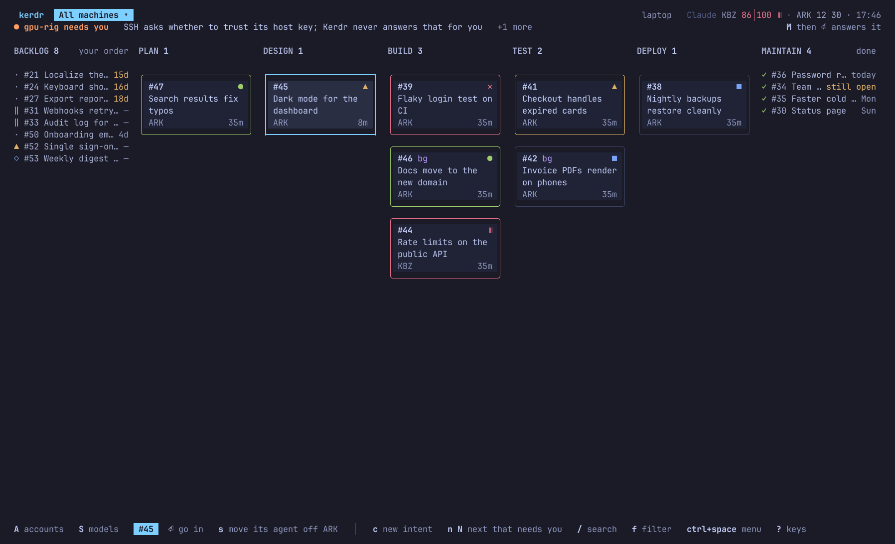

Kerdr is a full-screen board for people who run many coding agents at once in herdr. Every
record of work becomes a card, in a column for the stage its work is at. Agent conversations
without a linked record live in **Misc**, opened with `i` or `Ctrl+Space i`.
What needs you sorts to the top, and a box around a card means it's selected or waiting on you:
yellow when it asks you something, red when it's blocked, grey when nothing moves it until you do.
An agent at work has no box. Press Enter and herdr opens full screen on that card's
workspace. Press herdr's prefix and then `q`, herdr's own detach, and you're back on the board,
which has kept up while you were away.

Kerdr runs herdr under the hood. It doesn't draw panes or keep a task list of its own: herdr
does the terminal work, and Kerdr reads what herdr and your work records already say.

## The problem it solves

herdr is a great place to run agents. But once you have a dozen of them across a few sessions,
each workspace is a black box. You keep switching in to ask "are we done?", and you can't tell
whether to start something new or finish what's already open. That costs working memory, the
one resource you can't add more of.

Kerdr answers those questions in one look:

- **What needs me right now?** Agents asking a question, finished and waiting, or blocked come
  first, and `n` jumps to the next one.
- **How close to done is each thing?** Its column, its lifecycle rail, and its done-when
  criteria when the work records have them.
- **Should I take on more?** Session tabs show the slots each session has left. With account data,
  the top right shows each account's usage, grouped by provider, one figure per window it has,
  such as `Claude KBZ_C 86│100   Codex KBZ_X 7`: each account's newest reading from any machine,
  whichever machine you're looking at.

## Human on the loop

Meta's engineers describe how they built Forum with AI agents as moving
[from human-in-the-loop to human-on-the-loop](https://engineering.fb.com/2026/10/15/ml-applications/how-meta-built-forum-ai-native-engineering/):
the agent runs the iteration itself (plan, implement, build, test, correct, repeat) while the
engineer "sets the goal, watches the run, steps in when it drifts, and approves the result."

Kerdr is built for that way of working. You aren't inside every agent's loop; you sit above all
of them, and the board brings you the moments that are yours: a decision, an approval, a
question, something stuck. Everything else keeps running without you.

## Opinionated, on purpose

- **The stages are Anthropic's.** The columns are the six stages of Anthropic's
  [AI-native SDLC playbook](https://claude.com/resources/articles/the-ai-native-sdlc-playbook):
  Plan, Design, Build, Test, Deploy and Maintain, with a Backlog in front for work that hasn't
  started. Finished work lands in Maintain.
- **What needs you comes first,** in every column.
- **Work-in-progress limits.** Each herdr session holds three workspaces with an agent before
  Kerdr calls it full (change it in the config). A lane for background agents has no limit.
- **One workspace, one piece of work, one card.**
- **New work in your own words.** `c` opens one box: write what you want, the way you'd say it
  to an agent, and your record system's adapter writes it up. Ctrl+V adds a screenshot as an
  `[Image #1]` tag, as Claude Code does.
- **The same key does the same thing everywhere.** The keys that change a backlog card work on
  the board, in the backlog and in a peek, and the bottom line names them for the card you're
  on. Ctrl+Space lists them, with the same letters. Inside herdr, its own prefix and key
  bindings still apply, including Kerdr's two step-out keys.

## Features

### Peek at a card

`m` opens a card without leaving the board: where it is in its lifecycle, what it needs from
you, its done-when criteria, the agent's last update, and the latest lines of its log.

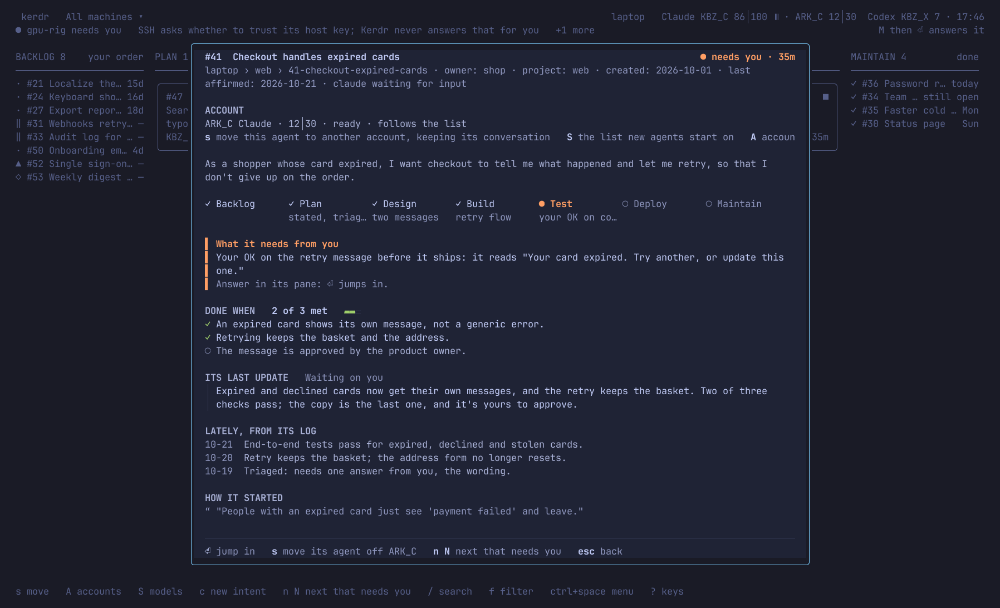

### Work inside a card

What an agent made for a card (its children, its undertaker, the follow-ups that came out of its
work) lives inside that card, not in a column of its own. The card's last line counts it, marks
each piece, and names the one that needs you, and its border turns yellow while one does. A done
card with work still open inside stays at the top of Maintain, saying "3 open". `o` opens the card's
own screen: the card itself first, then what's inside, grouped as needs you, under way, not started
and done, with the selected row's details beside it. `Enter` on a row goes where that work runs: a
child's tab, a follow-up's own workspace, or another machine. `Enter` on the board goes to the
card's own agent, in its own tab, never a child's. `n` and `prefix Space` stop on a piece that needs
you too. Feeds say which card a record sits in with `parent`, `undertaker_for` or `from`; see
[docs/feed.md](docs/feed.md#work-inside-a-card).

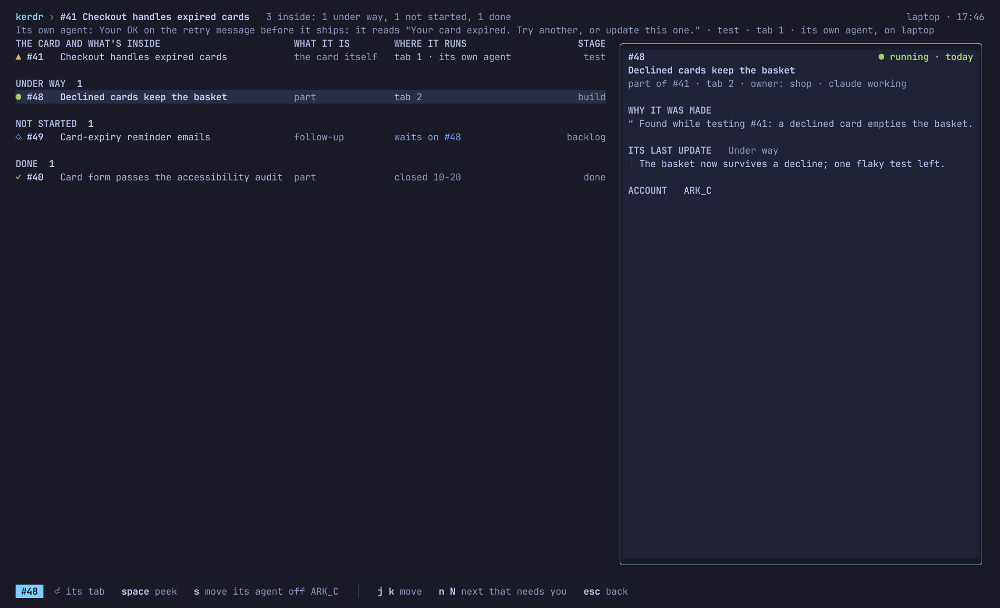

### Jump in, step out, keep going

- `Enter` focuses the card's herdr workspace and opens herdr full screen, with herdr's sidebar
  hidden, since the board does that job now. A card whose feed names a tab, for work running in
  one tab of a shared workspace, lands on that tab, and a card holding work lands on its own
  agent's tab; when that tab has closed, Kerdr offers to reopen it rather than open another.
  On backlog work nobody has started, `Enter` starts it, sending what `d` sends, so the key that
  gets you into work always gets you there; the backlog screen's `Enter` still peeks.
- `prefix q` is herdr's own detach. Inside Kerdr it brings you back to the board.
- `prefix Space` jumps straight to the next card that needs you, without stopping at the board,
  so you can answer several agents in a row.

`prefix` is herdr's prefix key: Ctrl+B unless you've changed it (Kerdr reads it from herdr's
config and names it in its hints). Kerdr's two keys, `prefix Space` and `prefix Backspace`, are
ordinary herdr custom commands. herdr runs a key's command from the server's own config, so add
them to each machine's herdr config with `kerdr herdr-keys --install`. Then they show up in
herdr's own keybinds menu (`prefix ?`) under *custom*, and they work over SSH. `prefix q` works
without them.

### Every session, every machine

The leftmost tab is the machine selector: `All`, then one machine at a time with `{` and `}`.
Only the selected machine's sessions appear beside it. `[` and `]` move between those sessions,
and `1` to `9` jump straight to a session. `0` returns to the all-machine overview. Machine and session keys work even when the current
board is empty; the empty view shows these keys and how to reach Misc conversations.

Kerdr reads every machine you list, over SSH, with one round trip per read and one shared SSH
connection per machine. It never answers a prompt for you. Jumping into a card on another
machine uses `herdr --remote`, so herdr draws on your machine and the agents keep running on
theirs. If that session was started by an older herdr than yours, `herdr --remote` would stop to
ask whether to restart it, which stops its agents, so Kerdr runs herdr there over plain SSH
instead until the versions match.

When a connection drops (a laptop on a train, a server rebooting), its cards stay on the board,
dimmed, with the time they were last seen. Kerdr retries with longer and longer waits, up to
15 seconds, so a laptop back from sleep has them again within seconds. `Enter` on one of those
cards waits for the machine, then jumps in, or says so if its workspace closed in the meantime.

Work that's still under way never leaves you at a dead end. When a card in a working column has
no workspace any more (its pane closed, the machine restarted, or an agent worked it outside
herdr), `Enter` asks your action backend to reopen it: it opens a workspace where the work
belongs, resumes the agent conversation that worked it (`claude --resume`, `codex resume`), and
Kerdr takes you straight in. The backend asks first when that would go past the session's
workspace limit or the conversation may still be open somewhere else. See
[docs/feed.md](docs/feed.md#reopening-work-whose-workspace-closed).

Kerdr runs one reopen, start or other change at a time, but `Enter` is never dropped while one
runs. On the card already being reopened it says how long that has taken; on any other card it
waits its turn, says so ("#41 opens once #39's answer is in"), and opens it as soon as the
running one answers, after its answer has been on screen a moment. A newer `Enter` replaces the
waiting one, and `Esc` on the board drops it (elsewhere `Esc` keeps its own job, such as saying no
to a question, and the waiting one keeps waiting). While herdr
gets ready on a card, the board says "Opening …", and keys pressed meanwhile are thrown away
rather than reaching the agent's prompt.

When `Enter` can't open a card, Kerdr says why in plain words. If herdr's window closes as soon as
it opens (SSH failing, herdr updating itself, versions that don't match), herdr's own message stays
on the screen until you press Enter. A herdr session that has stopped counts as a closed workspace,
so work under way reopens. A reopen that opened a new tab lands on that tab. When a card's
conversation runs in a terminal outside herdr, `Enter` says which and sends nothing; a second
`Enter` within five seconds goes on to ask about a second copy, even when it has to wait its turn.
When the machine asked turns out not to be the work's home any more, Kerdr asks its home instead,
once, and sends that work's actions there until the board catches up; when it can't (a machine it
doesn't list, or one not answering), it says so in its own words. Answers longer than 300
characters are cut short.

Done work isn't a dead end either. When an agent finishes and wraps itself before you're done
talking about it, `Enter` on its card in Maintain asks to reopen it: the backend always asks
first, saying it's done, and only your yes opens it again and resumes its conversation. See
[docs/feed.md](docs/feed.md#reopening-done-work).

Nor is work that's over but was never closed. When an agent stops without closing its work, or
its workspace closes under it, your feed can say no agent is at it, and its card says "no agent".
`C` marks any open card done, and `x` sets it aside as won't do, without starting an agent or
spending a token, once you've said yes: on work in the backlog, or on started work with no
workspace open. A card with a workspace open refuses, since its agent may be there, and the
backend refuses one whose agent it finds running elsewhere. See
[docs/feed.md](docs/feed.md#closing-work-with-no-agent).

Work an agent is still at can be stopped from the board too. `X` on its card asks, saying what it
will stop and close, then stops that agent, mid-step or idle, by closing its workspace (only its
tab, for a child running in its parent's workspace), and sets the work aside in Won't do, where
`u` brings it back. And `s` on the card moves just that card's agent to another account, keeping
its conversation, without touching the session's other agents or its owner's list, which is what
`S` edits. See [docs/feed.md](docs/feed.md#cancelling-work-an-agent-is-at).

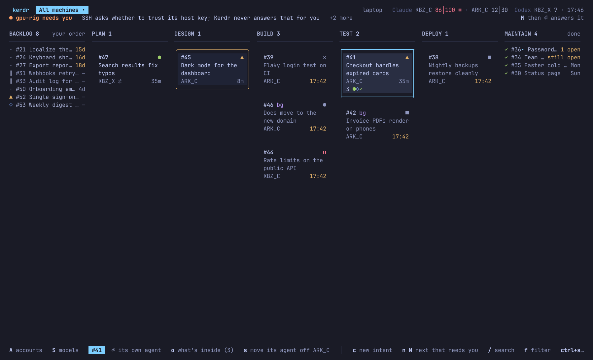

`M` lists every machine and every state it can be in: live, connecting, reconnecting, can't
reach, needs you (SSH wants a password, a passphrase or a host key, which you answer right
there), herdr too old or missing (`u` runs herdr's own setup, which asks before it changes
anything), and hidden.

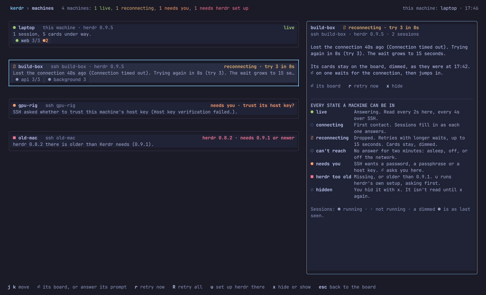

### Search everything

`/` on the board searches cards in the current machine, owner and project view, including work
that's already done. Session and workspace results follow the same filters; switch to All to search across machines.

### Search the list you're in

`/` in the backlog, in Won't do or in Misc searches only that list, where it is: the list narrows
as you type, each backlog card keeping its place number. Enter does what Enter does in that
list (peeks in the backlog, jumps in from Misc) on the card selected, and the search stays while
you peek or act on the cards it left, with the list's own keys. `/` changes it, and `Esc` clears
it; the next `Esc` leaves the list. Leaving the list ends its search.

### The backlog

`b` shows work waiting to start, in your chosen order. On the board's Backlog column, work that
waits on you before it starts (questions asked first, or a piece inside it asking) comes first, marked yellow, counts with what
waits on you, and keeps the column on screen when a narrow one would drop it. With an action adapter configured, these
keys change the selected backlog intent, on the board's Backlog column, in the backlog and in a
peek alike:

- `d` starts it in its recorded machine and session. At the usual work limit, Kerdr asks before
  starting another; the adapter still enforces its hard limit.
- `y` says you still want it. Its age is the time since you last said so, falling back to
  creation when it has never been reviewed. Agent updates do not reset this age. Creation stays
  visible in expanded details.
- `J` / `K` moves it down or up; in the backlog and a peek, `10K` moves it up ten places. `t`
  moves it to the top of its owner/project backlog, and `B` to the bottom. Priority stays separate from order.
- `x` moves it to **Won't do**, after confirmation. `w` opens that separate view; `u` brings the
  selected intent back. Its record and original creation date are retained.

`c` opens the new-intent box: one field for what you want, in your own words. Enter sends it and
closes the box at once, while the save carries on behind it: once it's saved, the backlog opens on
its card if you're still where the box closed, and if the save fails, Kerdr says so and keeps your
words for the next `c`. Shift+Enter, Alt+Enter or Ctrl+J starts a new line, and a paste keeps its
line breaks. Escape keeps your words for the next time you open it. The adapter files it in the backlog of the
session you're looking at and writes it up (see [docs/feed.md](docs/feed.md#actions)); Kerdr
shows it as being written up until that's done, and creating it never starts an agent by itself.

Ctrl+V in the box attaches the image on your clipboard, as Claude Code does: it goes in at the end
of your words as an `[Image #1]` tag, numbered within that intent, and travels with them to the
adapter. Pasting or dropping an image file's path attaches that file, and a file copied in a file
manager attaches too. Backspace right after a tag takes it out, with its image; only images whose
tags are still in your words are sent. Kerdr attaches PNG, JPEG, GIF and WebP, up to 10 MB each and
20 images or 20 MB in one intent, and says which limit an image is past. It reads the clipboard
with `wl-paste` (from wl-clipboard) under Wayland, `xclip` under X11, `osascript` on macOS and
PowerShell on Windows; where there's no desktop clipboard (over SSH, say), it says so, and a
pasted path still works.

`f` opens the filters. Its list is every owner (organization or tenant) and its projects, with
how much of each is under way and waiting; `j`/`k` or the arrows move, `/` searches the list, and
Enter shows only that one. `a` (or Tab there) cycles the provider herdr reports: All, Claude,
Codex, and additional detected providers; cards with no reported agent appear in All. `b` there
cycles background work: every card, only cards marked `bg` (their intent's lane is background, or
they run in a session `[board] unlimited` names), or none of them. `F` shows everything again.
These filters combine with machine and session selection, and the top of the board names them
while one is on. Organization work stays distinct from tenant work.

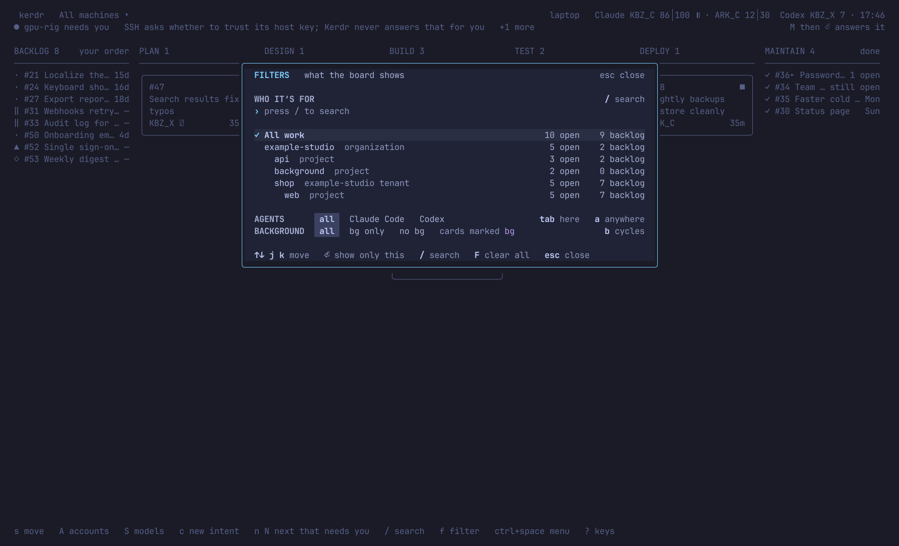

Controls are optional: [the action adapter contract](docs/feed.md#actions) lets your
own record system validate and persist changes. Without an adapter, Kerdr remains a reader.

### Accounts and ordered models

With an account-aware feed, each card shows its account at the bottom left and one status
at the top right: yellow ▲ needs you, red ⏸︎ waits for usage, green ● running, grey ■ idle.
A code is never cut short: on a narrow card the age gives way to it. `⇄` beside the code
means the work was handed over from another program (a Claude Code agent's account ran out,
say, and a fresh Codex agent took over from the work's log); its peek says from which account
and program, why, and when.
The bottom line names the first ready account for new work in the session you are viewing.
Older feeds retain the original board layout.

Accounts can be of any provider the feed describes: Claude and Codex today, a local model
later. Kerdr names none itself. The feed's `providers` give each one's name, the letter its
codes end with (`KBZ_C`, `KBZ_X`), its kinds of account in its own words, how it signs in,
and the usage windows it can have, so a provider added later is listed, added, signed in and
shown with no Kerdr release. The top bar groups accounts by provider and shows the windows
each has: `Claude KBZ_C 86│100 · ARK_C 12│30   Codex KBZ_X 7`, where a plan with only a weekly
limit shows one number.

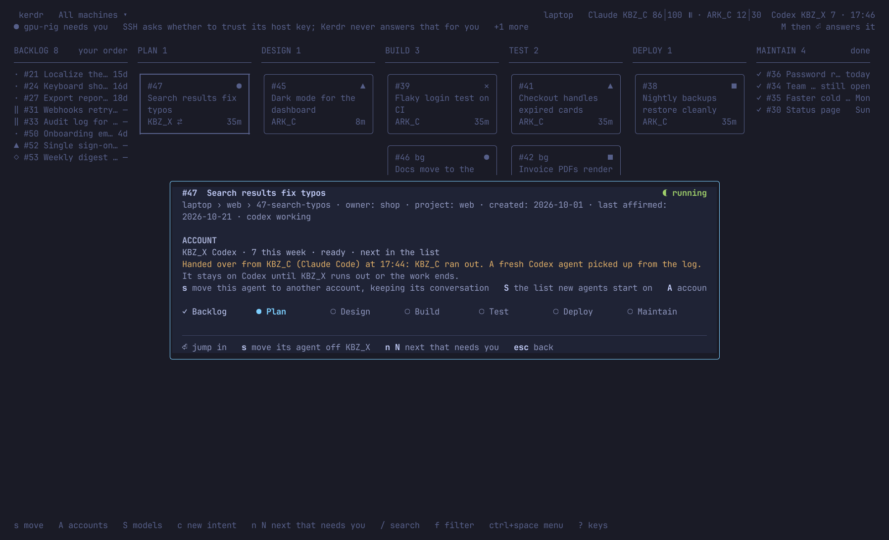

`A` opens accounts and each organization’s and tenant’s ordered model list, on the machine
tab you chose on the board, or else on the machine Kerdr runs on. `Tab` changes the machine
whose sign-in status you are viewing. Each account's line names its provider and kind; its
panel shows each usage window and where it stands in the lists. Tenants can follow their
organization or keep their own order. Select an owner with `j k`, choose a model with `h l`, then Enter makes
it first, `J K` reorders, and `a d` adds or drops in a draft that Enter saves. Backspace asks
before following the parent. `S` opens the
viewed session’s list as a draft, each line naming its provider, so the list reads as a
provider order: whatever is first and ready is what new work runs. Reorder, optionally tick
“move waiting sessions,” then save.
The tick sends a separate move request to every reachable configured feed machine.

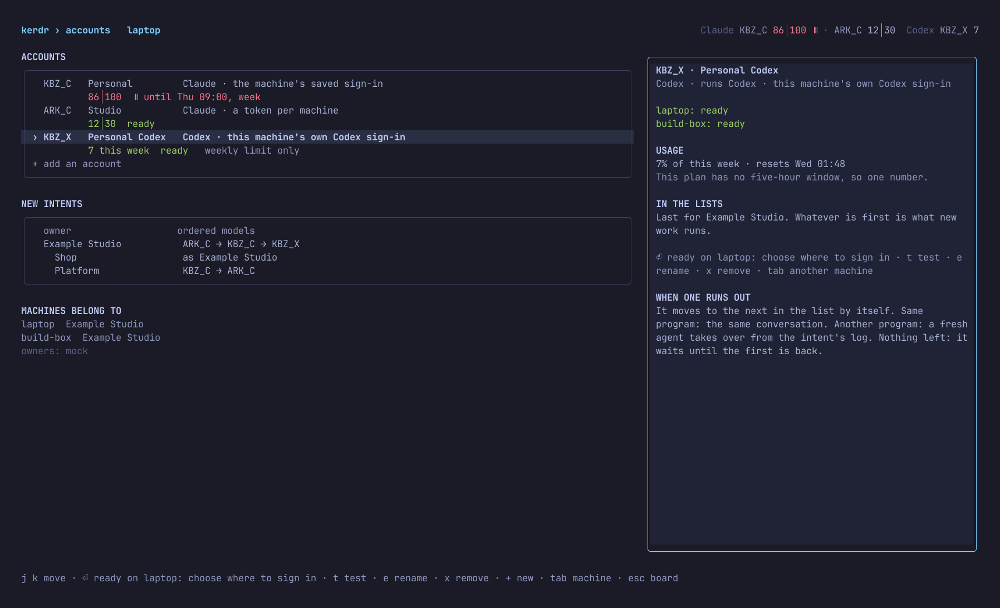

`s` opens the selected agent’s move picker. Choosing an account sends the request to that
agent’s machine and session. If its backend asks about a step or background job in progress,
a separate question appears. A confirmation applies only to that same conversation.
An agent the feed has no record of yet can be moved too, if its program is one the machine's
accounts run: Kerdr sends its pane with an empty `conversation`, and the backend takes the
conversation from herdr and records it. The backend owns fallback and resuming: same program,
same conversation; another program, a fresh agent from the work’s log; nothing left, wait for
an account to return. A move to an account another program runs is a hand-over, and the
backend's question says so before anything happens ("Hand #45 over to Codex?").

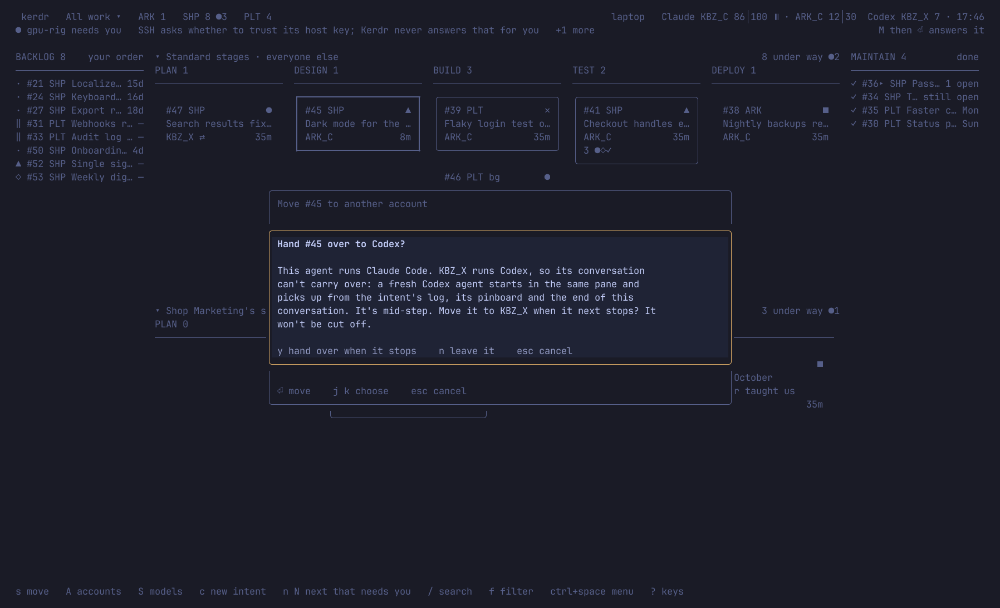

`A` then `+` asks which provider first, since the provider decides the program, then the
code (suggested as the owner's code, `_` and the provider's letter, like `ARK_X`), the name,
the kind of sign-in in that provider's words, anything else the provider asks for, and the
machines; then a separate sign-in on each machine.

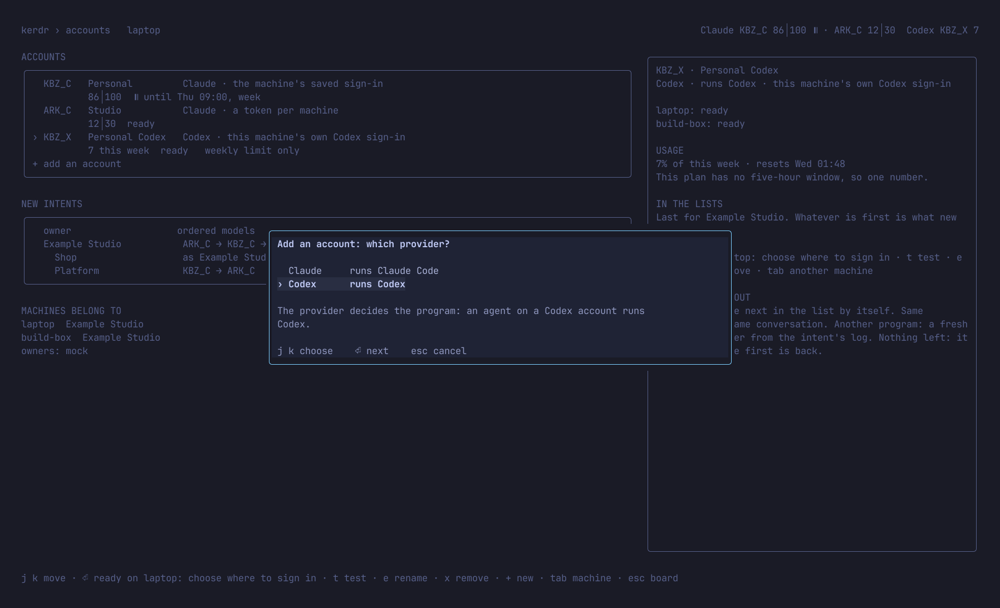

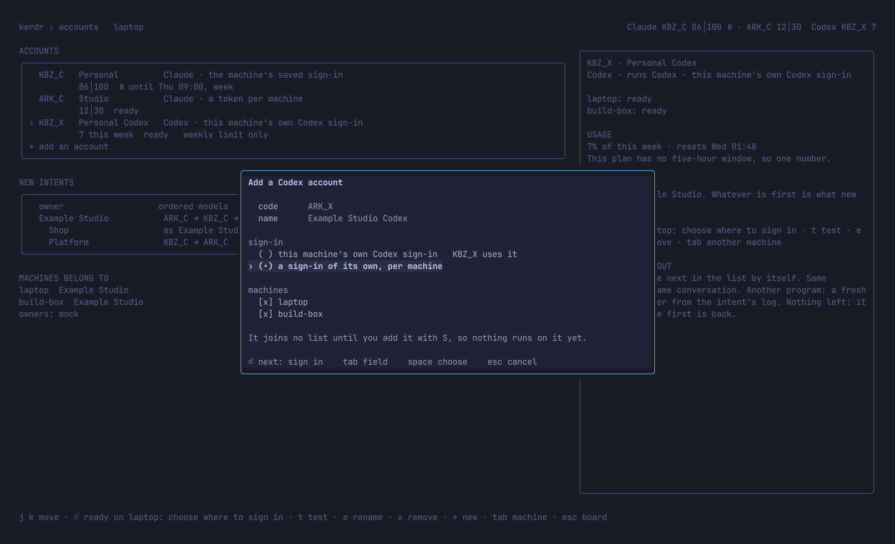

Enter on an existing account signs it in on the machine you are viewing,
then on every other machine that needs it, one after another, with no Tab needed; its hint
names them (“⏎ sign in on laptop, then build-box”). On an account already ready there, Enter
asks instead: it offers all the machines that need a sign-in one after another (when there are
several), each of them, or signing in again where it's ready.
`e` renames, `t` tests, and `x` removes after a question. The browser opens using the system’s
URL handler. `c` copies the visible link through the terminal clipboard and `o` opens it again.

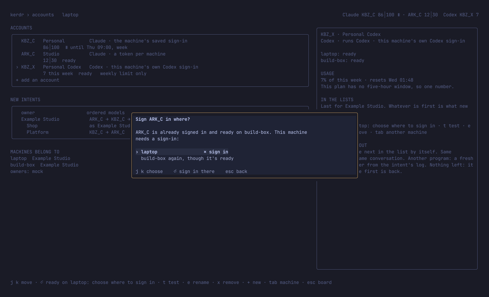

A provider whose page takes a code (Codex) shows that code, big, with how long it lasts: `c`
copies it, `o` opens the page again and `l` copies the link. You type it on the provider's
page, and nothing comes back to paste: the line ticks once you've allowed it.

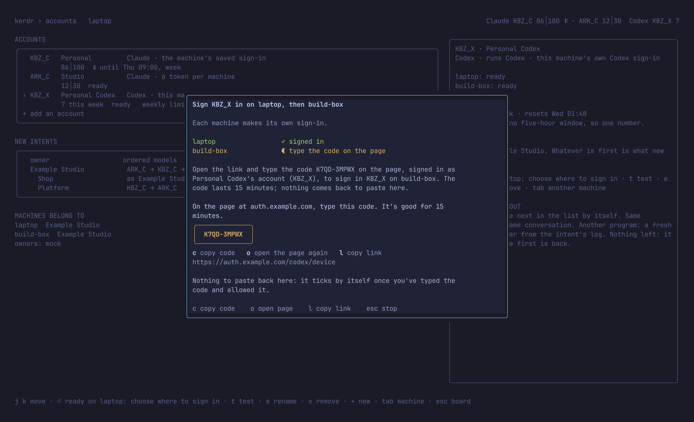

For a provider whose page gives a code back (Claude), Tab focuses the optional code field.
After you press Authorize, the page shows a long code:
paste it there and press Enter. A short code that claude.ai emails you goes in the browser
instead, and Kerdr says so rather than sending it. For a token account, `p` opens a masked
token field instead; a saved sign-in, or a copy that takes no token, doesn't offer it. Tokens
are sent only to that machine, removed from UI and result state on submission, and never
written to Kerdr’s logs or settings. Escape cancels the current browser sign-in. No sign-in
or action runs from the demo.

Where a machine keeps more than one copy of an account's sign-in (your agents' and its
tenants', say), each copy gets a line under the account: whether it is stored, whether it
works (and when that was checked), and a note such as "held by root". `j k` move between the
copy lines, Enter signs in the selected copy, whether it is missing, expired or wrong (one
that works already is asked about first), and `t` tests it. The sign-in names its copy, and the other copies stay as they are.

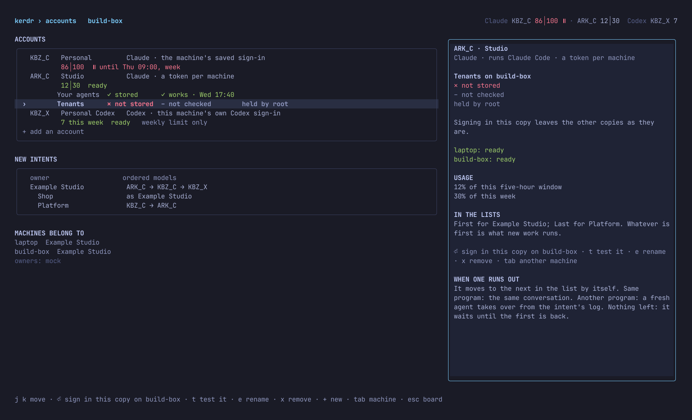

Windows uses a red ✕ for usage waits to avoid emoji rendering. Other terminals use U+23F8
with its text-presentation selector; `KERDR_PAUSE_GLYPH=x` selects the same fallback.
Account features work through the optional [feed and action contract](docs/feed.md#accounts).

### Keys

`?` lists every key, with a filter.

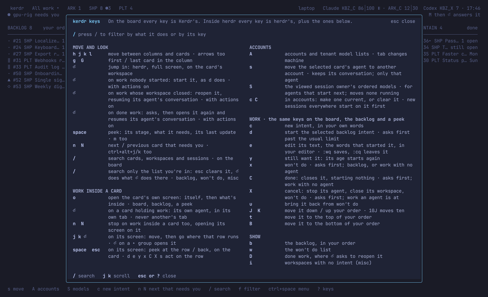

| On the board | |
|---|---|
| `h j k l` or arrows | move between columns and cards |
| `Enter` | jump in; on work nobody started, start it, as `d` does; on work whose workspace closed, reopen it; on done work, ask to reopen it (all three with actions) |
| `m` or `Space` | peek |
| `o` | the card's own screen: itself, then what's inside (also from the backlog and a peek); there, `j` `k` move, `Enter` goes where the row runs or opens a folded group, `Space` peeks, `d` `y` `x` `C` `X` `s` act on the row, `Esc` goes back |
| `n` / `N` | next / previous card that needs you, or work inside a card, opening its screen on it (also `Ctrl+Alt+j/k`) |
| `[` / `]` | previous / next session (also `Ctrl+Alt+h/l`, `Tab`) |
| `{` / `}` | previous / next machine (also `Ctrl+Alt+Shift+h/l`) |
| `0`, `1`..`9` | every session, or session tab 1 to 9 |
| `/` | search everything; in the backlog, Won't do or Misc, search only that list (`Esc` clears it) |
| `c` | new intent, in your own words (in it, `Ctrl+V` attaches the clipboard's image) |
| `d` `y` `x` `u` `J` `K` `t` `B` | start, still want it, won't do, bring back, move down / up, to the top, to the bottom (the selected backlog intent) |
| `C` | done: close the selected intent, starting nothing (backlog work, or started work with no workspace open; asks first). `x` sets started work with no workspace aside too |
| `X` | cancel: stop the selected card's agent, close its workspace (or only a child's tab), and set it aside in Won't do (work an agent is at; asks first) |
| `f` / `F` | filters / show everything: in `f`, Enter shows only one owner or project, `/` searches that list, `a` or `Tab` cycles agents, `b` cycles background work (all, bg only, no bg) |
| `A` / `S` / `s` | accounts / the viewed session owner’s ordered models, for agents that start next / move the selected card’s agent to another account, keeping its conversation |
| `a` | cycle agents: all, each program the feeds name, then any other herdr reports |
| `b` | backlog |
| `w` | toggle Won't do view |
| `i` | Misc: workspaces with no record |
| `Ctrl+Space` | a menu of the work and view keys, with the same letters |
| `M` | machines |
| `r` / `R` | retry a machine that isn't answering / all of them |
| `?` | keys |
| `q` | quit (every session keeps running) |

| Inside herdr | |
|---|---|
| `prefix q` | back to the board (herdr's own detach) |
| `prefix Space` | next card that needs you, work inside cards included, straight to its tab |
| `prefix Backspace` | back to the board, as listed in herdr's menu |

`prefix` is herdr's prefix key, Ctrl+B unless you've set another. `prefix Space` and
`prefix Backspace` need `kerdr herdr-keys --install` on that machine.

## How it works

**herdr under the hood.** Kerdr uses only herdr's public command line. Each read runs one short
shell script on the machine: herdr's version, `herdr session list`, and
`herdr --session NAME api snapshot` for every running session, which returns its workspaces,
agents and their states in one call, and which panes are helpers' (a `role=helper` token), whose
work doesn't count as the card's own agent at work. Jumping in runs `herdr workspace focus`, then herdr itself
as Kerdr's child process, with a copy of your herdr config that hides the sidebar. Settings you
change inside a window Kerdr opened last until it opens the next one; change them in herdr's own
config to keep them.

**Kept up to date with herdr.** herdr ships often. Kerdr needs herdr 0.9.1 or newer, and every
week its CI installs the latest herdr release, runs Kerdr's tests against a real herdr server,
and opens an issue if anything has changed under it.

**Misc conversations.** Every herdr workspace with an agent remains reachable, including fresh
chats and experiments with no task record. These appear in **Misc** (`i`, or `Ctrl+Space i`),
outside the work columns and their attention counts. Enter opens the conversation, Space peeks,
and Escape returns to the board. Machine, session and provider filters still apply. When a feed
record claims the workspace, its card moves into the record's phase automatically. A temporary
feed error preserves the last successful records.

Agents can report their status from inside their pane:

```sh
kerdr report --stage test --status needs-you --note "your OK on the retry copy" --progress 2/3
```

That writes herdr workspace tokens, so it needs nothing beyond herdr. Reporting a phase by
itself does not create a task record or move an unlinked conversation out of Misc.

Progress reported this way shows on the card, next to its status.

**Card feeds.** If you keep records of your work (tickets, intents, a folder of markdown files),
point Kerdr at a command that prints them as JSON, and Kerdr merges them with what herdr sees:
stage, status, what it needs from you, done-when criteria, its log, dependencies, and the
backlog. The format is in [docs/feed.md](docs/feed.md). Kerdr runs the feed on each machine, so
a feed can read that machine's own state.

## Install

You need [herdr](https://herdr.dev/docs/install/) 0.9.1 or newer on every machine you want on
the board.

```sh
curl -fsSL https://raw.githubusercontent.com/drewdunne/kerdr/main/install.sh | sh
```

That puts the release binary for your platform in `~/.local/bin`. Releases cover Linux (x86_64
and ARM), Apple Silicon Macs, and native Windows x86_64. On Windows, download
[`kerdr-x86_64-pc-windows-msvc.zip`](https://github.com/drewdunne/kerdr/releases/latest/download/kerdr-x86_64-pc-windows-msvc.zip),
extract `kerdr.exe` to a folder on your PATH, and run it in Windows Terminal. Install
[Herdr for Windows](https://herdr.dev/docs/windows-beta/) first. The ZIP has a matching SHA256
checksum in the same release. See [Windows setup and requirements](docs/windows.md).

Anywhere else, build it:

```sh
cargo install --git https://github.com/drewdunne/kerdr
```

Then, on each machine, add Kerdr's two keys to herdr's config and reload your sessions:

```sh
kerdr herdr-keys --install
herdr --session NAME server reload-config
```

Try it without herdr first, on a made-up team's board:

```sh
kerdr demo
```

`kerdr doctor` checks every machine: whether Kerdr can reach it, which herdr it runs, whether
its feed works, and whether Kerdr's keys are in its herdr config.

## Configure

Kerdr works with no config: it shows this machine. To add machines and a feed, write
`~/.config/kerdr/config.toml` (Windows: `%APPDATA%\kerdr\config.toml`):

```toml
[feed]
# A command each machine runs to print its cards (docs/feed.md). Optional.
command = "~/bin/my-cards --json"
every = 15

[board]
slots = 3                   # workspaces with an agent per session before it's full
unlimited = ["*-bg", "background"] # sessions with no limit; * matches any text
skip = []                   # sessions never shown
only = []                   # show only these sessions

[[machine]]
name = "build-box"          # the name on the board
ssh = "build-box"           # any SSH target: a Host from ~/.ssh/config, user@host, ...

[[machine]]
name = "laptop"
ssh = "laptop"
```

`[board] unlimited` matches whole session names, with `*` matching zero or more characters
anywhere in the name. For example, `"*-bg"` includes `pick4me-bg` and `arknet-bg`, but not
`pick4me`; `"background"` remains an exact match. Other characters are literal, and matching
is case-sensitive. A feed's explicit slot counts and limits still take precedence.

The same file works on every machine: the machine whose hostname matches a `name` is "this
machine", and Kerdr reaches the others over SSH. If you use the herdr session picker for
Omarchy, Kerdr also reads its list of machines (`~/.config/herdr-sessions/machines`); set
`[machines] picker = false` to turn that off.

SSH runs non-interactively (`BatchMode`), so use keys loaded in your agent. When SSH needs
you, the machine shows *needs you*, and `M` then `Enter` lets you answer it.

### Colours

On Omarchy, Kerdr takes its colours from your current theme, and changes with it within a second
or so when you pick another, while it's open. Anywhere else it uses Tokyo Night. To take them from
another theme file, or to keep Tokyo Night on Omarchy:

```toml
[theme]
colors = "~/my-theme/colors.toml"   # an Omarchy-style colors.toml; "" keeps Tokyo Night
```

The file needs `background` and `foreground`, and Kerdr uses `red`, `green`, `yellow`, `orange`,
`blue`, `magenta`, `cyan`, `selection`, `muted`, `lighter_background`, `dark_foreground` and
`bright_foreground` when it has them, or `color0` to `color15`, as Omarchy's own themes do. A
colour too close to the background to read is lightened (or, on a light theme, darkened) until it
can be. The selected card takes the theme's `selection` only when text reads on it as it is; a
theme whose selection needs a text colour of its own (Synthwave '84's is white) gets its background
tinted with its `accent` instead.

## Status

Kerdr is new (0.15). Reading and navigation work without an action adapter. Opting into
`[actions] command` enables record changes, dispatch and reopening through your own adapter, on
the record's home machine. Commands run in the background and show their result; an unknown result
is never retried automatically. In herdr, Kerdr focuses the workspace you jump into, shows a
short hint there, and clears the short-lived token its keys leave. herdr moves every window attached to a session when its focus changes, so if
you also keep a plain herdr window open on the same session, it follows.

## License

MIT
