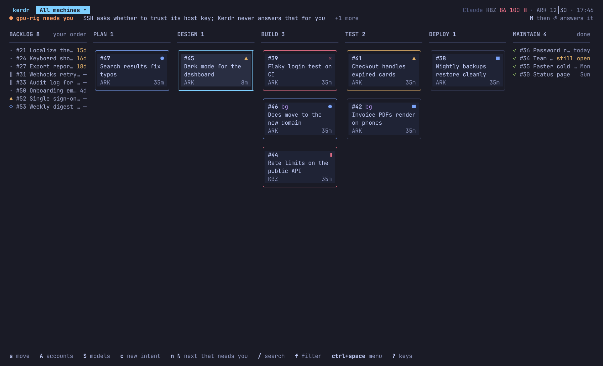
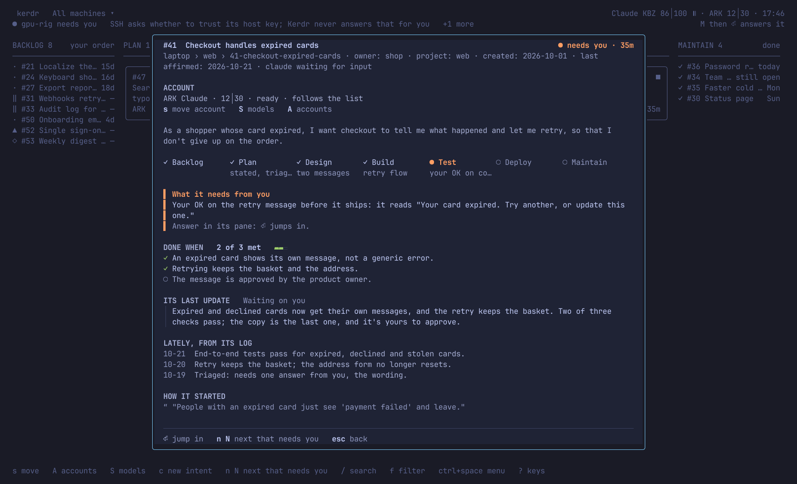
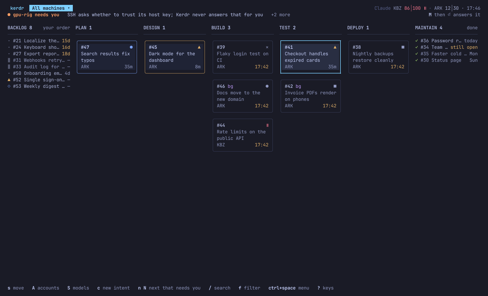
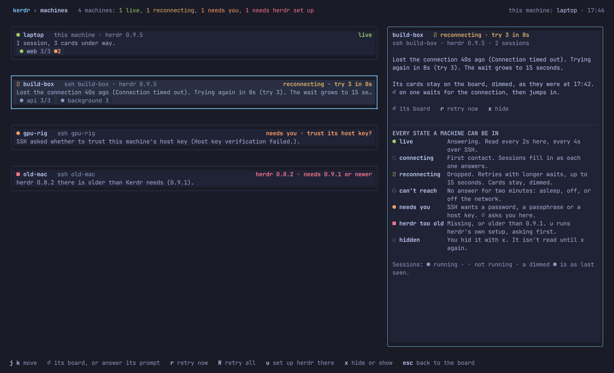
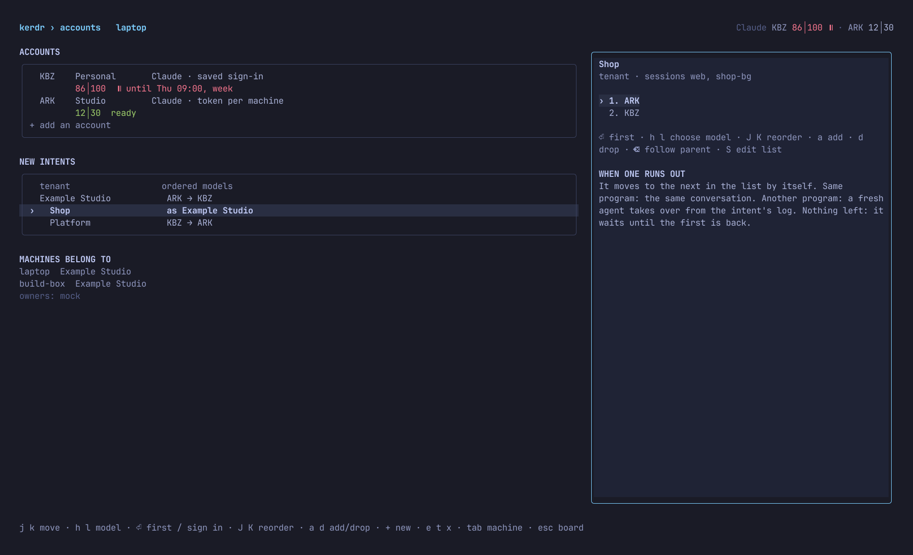
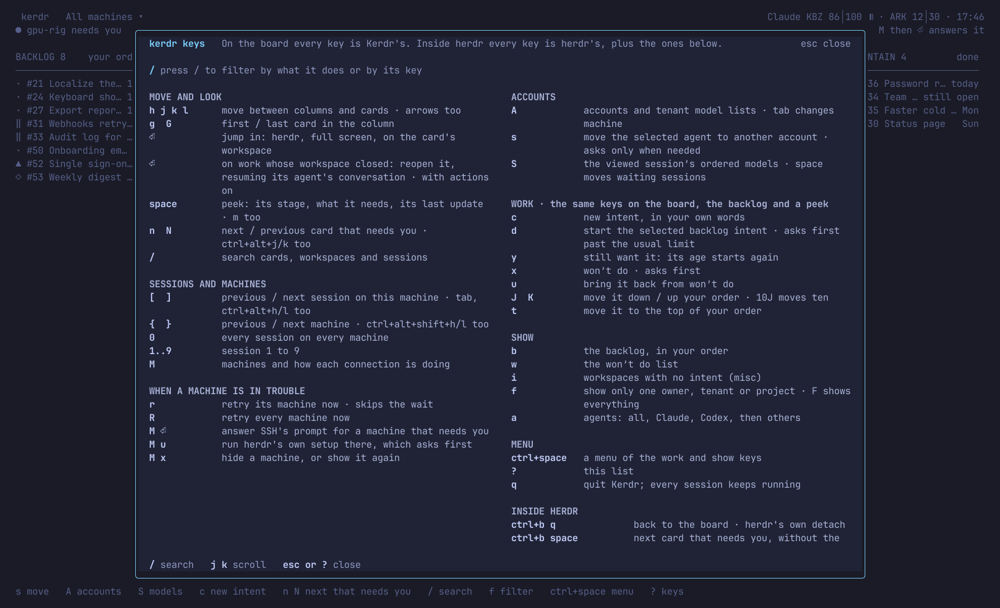

# Kerdr

**An opinionated kanban cockpit for driving [herdr](https://herdr.dev) sessions.**



Kerdr is a full-screen board for people who run many coding agents at once in herdr. Every
record of work becomes a card, in a column for the stage its work is at. Agent conversations
without a linked record live in **Misc**, opened with `i` or `Ctrl+Space i`.
What needs you sorts to the top. Press Enter and herdr opens full screen on that card's
workspace. Press herdr's prefix and then `q`, herdr's own detach, and you're back on the board,
which has kept up while you were away.

Kerdr runs herdr under the hood. It doesn't draw panes or keep a task list of its own: herdr
does the terminal work, and Kerdr reads what herdr and your work records already say.

## The problem it solves

herdr is a great place to run agents. But once you have a dozen of them across a few sessions,
each workspace is a black box. You keep switching in to ask "are we done?", and you can't tell
whether to start something new or finish what's already open. That costs working memory, the
one resource you can't add more of.

Kerdr answers those questions in one look:

- **What needs me right now?** Agents asking a question, finished and waiting, or blocked come
  first, and `n` jumps to the next one.
- **How close to done is each thing?** Its column, its lifecycle rail, and its done-when
  criteria when the work records have them.
- **Should I take on more?** Session tabs show the slots each session has left. With account data,
  the top right shows each provider’s five-hour and weekly usage, such as `KBZ 86│100`.

## Human on the loop

Meta's engineers describe how they built Forum with AI agents as moving
[from human-in-the-loop to human-on-the-loop](https://engineering.fb.com/2026/10/15/ml-applications/how-meta-built-forum-ai-native-engineering/):
the agent runs the iteration itself (plan, implement, build, test, correct, repeat) while the
engineer "sets the goal, watches the run, steps in when it drifts, and approves the result."

Kerdr is built for that way of working. You aren't inside every agent's loop; you sit above all
of them, and the board brings you the moments that are yours: a decision, an approval, a
question, something stuck. Everything else keeps running without you.

## Opinionated, on purpose

- **The stages are Anthropic's.** The columns are the six stages of Anthropic's
  [AI-native SDLC playbook](https://claude.com/resources/articles/the-ai-native-sdlc-playbook):
  Plan, Design, Build, Test, Deploy and Maintain, with a Backlog in front for work that hasn't
  started. Finished work lands in Maintain.
- **What needs you comes first,** in every column.
- **Work-in-progress limits.** Each herdr session holds three workspaces with an agent before
  Kerdr calls it full (change it in the config). A lane for background agents has no limit.
- **One workspace, one piece of work, one card.**
- **New work in your own words.** `c` opens one box: write what you want, the way you'd say it
  to an agent, and your record system's adapter writes it up.
- **The same key does the same thing everywhere.** The keys that change a backlog card work on
  the board, in the backlog and in a peek, and the bottom line names them for the card you're
  on. Ctrl+Space lists them, with the same letters. Inside herdr, its own prefix and key
  bindings still apply, including Kerdr's two step-out keys.

## Features

### Peek at a card

`m` opens a card without leaving the board: where it is in its lifecycle, what it needs from
you, its done-when criteria, the agent's last update, and the latest lines of its log.



### Jump in, step out, keep going

- `Enter` focuses the card's herdr workspace and opens herdr full screen, with herdr's sidebar
  hidden, since the board does that job now. A card whose feed names a tab, for work running in
  one tab of a shared workspace, lands on that tab.
- `prefix q` is herdr's own detach. Inside Kerdr it brings you back to the board.
- `prefix Space` jumps straight to the next card that needs you, without stopping at the board,
  so you can answer several agents in a row.

`prefix` is herdr's prefix key: Ctrl+B unless you've changed it (Kerdr reads it from herdr's
config and names it in its hints). Kerdr's two keys, `prefix Space` and `prefix Backspace`, are
ordinary herdr custom commands. herdr runs a key's command from the server's own config, so add
them to each machine's herdr config with `kerdr herdr-keys --install`. Then they show up in
herdr's own keybinds menu (`prefix ?`) under *custom*, and they work over SSH. `prefix q` works
without them.

### Every session, every machine

The leftmost tab is the machine selector: `All`, then one machine at a time with `{` and `}`.
Only the selected machine's sessions appear beside it. `[` and `]` move between those sessions,
and `1` to `9` jump straight to a session. `0` returns to the all-machine overview. Machine and session keys work even when the current
board is empty; the empty view shows these keys and how to reach Misc conversations.

Kerdr reads every machine you list, over SSH, with one round trip per read and one shared SSH
connection per machine. It never answers a prompt for you. Jumping into a card on another
machine uses `herdr --remote`, so herdr draws on your machine and the agents keep running on
theirs. If that session was started by an older herdr than yours, `herdr --remote` would stop to
ask whether to restart it, which stops its agents, so Kerdr runs herdr there over plain SSH
instead until the versions match.

When a connection drops (a laptop on a train, a server rebooting), its cards stay on the board,
dimmed, with the time they were last seen. Kerdr retries with longer and longer waits, up to
15 seconds, so a laptop back from sleep has them again within seconds. `Enter` on one of those
cards waits for the machine, then jumps in, or says so if its workspace closed in the meantime.

Work that's still under way never leaves you at a dead end. When a card in a working column has
no workspace any more (its pane closed, the machine restarted, or an agent worked it outside
herdr), `Enter` asks your action backend to reopen it: it opens a workspace where the work
belongs, resumes the agent conversation that worked it (`claude --resume`, `codex resume`), and
Kerdr takes you straight in. The backend asks first when that would go past the session's
workspace limit or the conversation may still be open somewhere else. See
[docs/feed.md](docs/feed.md#reopening-work-whose-workspace-closed).



`M` lists every machine and every state it can be in: live, connecting, reconnecting, can't
reach, needs you (SSH wants a password, a passphrase or a host key, which you answer right
there), herdr too old or missing (`u` runs herdr's own setup, which asks before it changes
anything), and hidden.



### Search everything

`/` searches cards in the current machine, owner and project view, including work that's
already done. Session and workspace results follow the same filters; switch to All to search across machines.

### The backlog

`b` shows work waiting to start, in your chosen order. With an action adapter configured, these
keys change the selected backlog intent, on the board's Backlog column, in the backlog and in a
peek alike:

- `d` starts it in its recorded machine and session. At the usual work limit, Kerdr asks before
  starting another; the adapter still enforces its hard limit.
- `y` says you still want it. Its age is the time since you last said so, falling back to
  creation when it has never been reviewed. Agent updates do not reset this age. Creation stays
  visible in expanded details.
- `J` / `K` moves it down or up; in the backlog and a peek, `10K` moves it up ten places. `t`
  moves it to the top of its owner/project backlog. Priority stays separate from order.
- `x` moves it to **Won't do**, after confirmation. `w` opens that separate view; `u` brings the
  selected intent back. Its record and original creation date are retained.

`c` opens the new-intent box: one field for what you want, in your own words. Enter sends it;
Shift+Enter, Alt+Enter or Ctrl+J starts a new line, and a paste keeps its line breaks. Escape
keeps your words for the next time you open it. The adapter files it in the backlog of the
session you're looking at and writes it up (see [docs/feed.md](docs/feed.md#actions)); Kerdr
shows it as being written up until that's done, and creating it never starts an agent by itself.

`f` lists every owner (organization or tenant) and its projects, with how much of each is under
way and waiting; type to narrow the list and Enter to show only that one. `F` shows everything
again. `a` cycles the provider herdr reports: All, Claude, Codex, and additional detected
providers. Cards with no reported agent appear in All. These filters combine with machine and
session selection, and the top of the board names them while one is on. Organization work stays
distinct from tenant work.

Controls are optional: [the action adapter contract](docs/feed.md#actions) lets your
own record system validate and persist changes. Without an adapter, Kerdr remains a reader.

### Accounts and ordered models

With an account-aware feed, each card shows its account at the bottom left and one status
at the top right: yellow ▲ needs you, red ⏸︎ waits for usage, blue ● running, grey ■ idle.
The bottom line names the first account for new work in the session you are viewing.
Older feeds retain the original board layout.

`A` opens accounts and each organization’s and tenant’s ordered model list. `Tab` changes
the machine whose sign-in status you are viewing. Tenants can follow their organization or
keep their own order. Select an owner with `j k`, choose a model with `h l`, then Enter makes
it first, `J K` reorders, `a d` adds or drops, and Backspace follows the parent. `S` opens the
viewed session’s list as a draft: reorder, optionally tick “move waiting sessions,” then save.
The tick sends a separate move request to every reachable configured feed machine.



`s` opens the selected agent’s move picker. Choosing an account sends the request to that
agent’s machine and session. If its backend asks about a step or background job in progress,
a separate question appears. A confirmation applies only to that same conversation.
The backend owns fallback and resuming: same program, same conversation; another program,
a fresh agent from the work’s log; nothing left, wait for an account to return.

`A` then `+` adds a Claude account: code, name, and machines, then a separate browser sign-in
on each machine. Enter on an existing account signs it in again on the selected machine;
`e` renames, `t` tests, and `x` removes after a question. The browser opens using the system’s
URL handler. `c` copies the link through the terminal clipboard and `o` opens it again.
Tab focuses the optional page-code field; paste or type the code and press Enter. `p` opens
a masked token field instead. Tokens are sent only to that machine, removed from UI and
result state on submission, and never written to Kerdr’s logs or settings. Escape cancels
the current browser sign-in. No sign-in or action runs from the demo.

Windows uses a red ✕ for usage waits to avoid emoji rendering. Other terminals use U+23F8
with its text-presentation selector; `KERDR_PAUSE_GLYPH=x` selects the same fallback.
Account features work through the optional [feed and action contract](docs/feed.md#accounts).

### Keys

`?` lists every key, with a filter.



| On the board | |
|---|---|
| `h j k l` or arrows | move between columns and cards |
| `Enter` | jump in; on work whose workspace closed, reopen it (with actions) |
| `m` or `Space` | peek |
| `n` / `N` | next / previous card that needs you (also `Ctrl+Alt+j/k`) |
| `[` / `]` | previous / next session (also `Ctrl+Alt+h/l`, `Tab`) |
| `{` / `}` | previous / next machine (also `Ctrl+Alt+Shift+h/l`) |
| `0`, `1`..`9` | every session, or session tab 1 to 9 |
| `/` | search |
| `c` | new intent, in your own words |
| `d` `y` `x` `u` `J` `K` `t` | start, still want it, won't do, bring back, move down / up, to the top (the selected backlog intent) |
| `f` / `F` | show only one owner or project / show everything |
| `A` / `S` / `s` | accounts / viewed session’s ordered models / move selected agent |
| `a` | cycle provider: All, Claude, Codex, and detected providers |
| `b` | backlog |
| `w` | toggle Won't do view |
| `i` | Misc: workspaces with no record |
| `Ctrl+Space` | a menu of the work and view keys, with the same letters |
| `M` | machines |
| `r` / `R` | retry a machine that isn't answering / all of them |
| `?` | keys |
| `q` | quit (every session keeps running) |

| Inside herdr | |
|---|---|
| `prefix q` | back to the board (herdr's own detach) |
| `prefix Space` | next card that needs you |
| `prefix Backspace` | back to the board, as listed in herdr's menu |

`prefix` is herdr's prefix key, Ctrl+B unless you've set another. `prefix Space` and
`prefix Backspace` need `kerdr herdr-keys --install` on that machine.

## How it works

**herdr under the hood.** Kerdr uses only herdr's public command line. Each read runs one short
shell script on the machine: herdr's version, `herdr session list`, and
`herdr --session NAME api snapshot` for every running session, which returns its workspaces,
agents and their states in one call. Jumping in runs `herdr workspace focus`, then herdr itself
as Kerdr's child process, with a copy of your herdr config that hides the sidebar. Settings you
change inside a window Kerdr opened last until it opens the next one; change them in herdr's own
config to keep them.

**Kept up to date with herdr.** herdr ships often. Kerdr needs herdr 0.9.1 or newer, and every
week its CI installs the latest herdr release, runs Kerdr's tests against a real herdr server,
and opens an issue if anything has changed under it.

**Misc conversations.** Every herdr workspace with an agent remains reachable, including fresh
chats and experiments with no task record. These appear in **Misc** (`i`, or `Ctrl+Space i`),
outside the work columns and their attention counts. Enter opens the conversation, Space peeks,
and Escape returns to the board. Machine, session and provider filters still apply. When a feed
record claims the workspace, its card moves into the record's phase automatically. A temporary
feed error preserves the last successful records.

Agents can report their status from inside their pane:

```sh
kerdr report --stage test --status needs-you --note "your OK on the retry copy" --progress 2/3
```

That writes herdr workspace tokens, so it needs nothing beyond herdr. Reporting a phase by
itself does not create a task record or move an unlinked conversation out of Misc.

Progress reported this way shows on the card, next to its status.

**Card feeds.** If you keep records of your work (tickets, intents, a folder of markdown files),
point Kerdr at a command that prints them as JSON, and Kerdr merges them with what herdr sees:
stage, status, what it needs from you, done-when criteria, its log, dependencies, and the
backlog. The format is in [docs/feed.md](docs/feed.md). Kerdr runs the feed on each machine, so
a feed can read that machine's own state.

## Install

You need [herdr](https://herdr.dev/docs/install/) 0.9.1 or newer on every machine you want on
the board.

```sh
curl -fsSL https://raw.githubusercontent.com/drewdunne/kerdr/main/install.sh | sh
```

That puts the release binary for your platform in `~/.local/bin`. Releases cover Linux (x86_64
and ARM), Apple Silicon Macs, and native Windows x86_64. On Windows, download
[`kerdr-x86_64-pc-windows-msvc.zip`](https://github.com/drewdunne/kerdr/releases/latest/download/kerdr-x86_64-pc-windows-msvc.zip),
extract `kerdr.exe` to a folder on your PATH, and run it in Windows Terminal. Install
[Herdr for Windows](https://herdr.dev/docs/windows-beta/) first. The ZIP has a matching SHA256
checksum in the same release. See [Windows setup and requirements](docs/windows.md).

Anywhere else, build it:

```sh
cargo install --git https://github.com/drewdunne/kerdr
```

Then, on each machine, add Kerdr's two keys to herdr's config and reload your sessions:

```sh
kerdr herdr-keys --install
herdr --session NAME server reload-config
```

Try it without herdr first, on a made-up team's board:

```sh
kerdr demo
```

`kerdr doctor` checks every machine: whether Kerdr can reach it, which herdr it runs, whether
its feed works, and whether Kerdr's keys are in its herdr config.

## Configure

Kerdr works with no config: it shows this machine. To add machines and a feed, write
`~/.config/kerdr/config.toml` (Windows: `%APPDATA%\kerdr\config.toml`):

```toml
[feed]
# A command each machine runs to print its cards (docs/feed.md). Optional.
command = "~/bin/my-cards --json"
every = 15

[board]
slots = 3                   # workspaces with an agent per session before it's full
unlimited = ["background"]  # sessions with no limit
skip = []                   # sessions never shown
only = []                   # show only these sessions

[[machine]]
name = "build-box"          # the name on the board
ssh = "build-box"           # any SSH target: a Host from ~/.ssh/config, user@host, ...

[[machine]]
name = "laptop"
ssh = "laptop"
```

The same file works on every machine: the machine whose hostname matches a `name` is "this
machine", and Kerdr reaches the others over SSH. If you use the herdr session picker for
Omarchy, Kerdr also reads its list of machines (`~/.config/herdr-sessions/machines`); set
`[machines] picker = false` to turn that off.

SSH runs non-interactively (`BatchMode`), so use keys loaded in your agent. When SSH needs
you, the machine shows *needs you*, and `M` then `Enter` lets you answer it.

## Status

Kerdr is new (0.5). Reading and navigation work without an action adapter. Opting into
`[actions] command` enables record changes, dispatch and reopening through your own adapter, on
the record's home machine. Commands run in the background and show their result; an unknown result
is never retried automatically. In herdr, Kerdr focuses the workspace you jump into, shows a
short hint there, and clears the short-lived token its keys leave. herdr moves every window attached to a session when its focus changes, so if
you also keep a plain herdr window open on the same session, it follows.

## License

MIT
