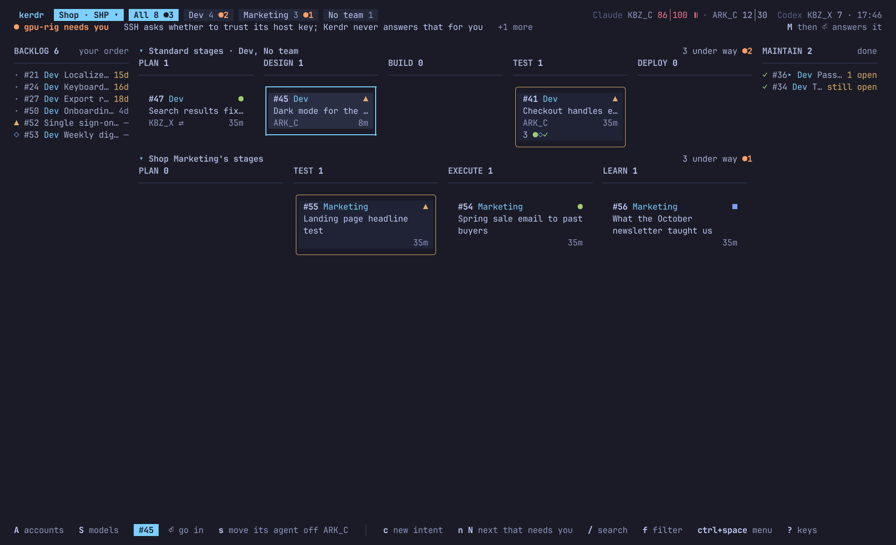
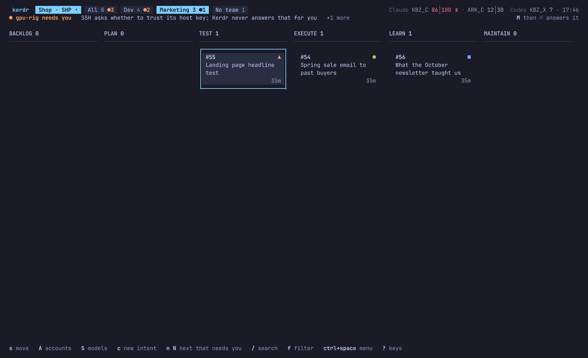

# Kerdr

**An opinionated kanban cockpit for driving [herdr](https://herdr.dev) sessions.**


Kerdr is a full-screen board for people who run many coding agents at once in herdr. Every
record of work becomes a card, in a column for the stage its work is at. Agent conversations
without a linked record live in **Misc**, opened with `i` or `Ctrl+Space i`.
What needs you sorts to the top, and a box around a card means it's selected or waiting on you:
yellow when it asks you something, red when it's blocked, grey when nothing moves it until you do.
An agent at work has no box. Press Enter and herdr opens full screen on that card's
workspace. Press herdr's prefix and then `q`, herdr's own detach, and you're back on the board,
which has kept up while you were away.

Kerdr runs herdr under the hood. It doesn't draw panes or keep a task list of its own: herdr
does the terminal work, and Kerdr reads what herdr and your work records already say.

## The problem it solves

herdr is a great place to run agents. But once you have a dozen of them across a few sessions,
each workspace is a black box. You keep switching in to ask "are we done?", and you can't tell
whether to start something new or finish what's already open. That costs working memory, the
one resource you can't add more of.

Kerdr answers those questions in one look:

- **What needs me right now?** Agents asking a question, finished and waiting, or blocked come
  first, and `n` jumps to the next one.
- **How close to done is each thing?** Its column, its lifecycle rail, and its done-when
  criteria when the work records have them.
- **Should I take on more?** Session tabs show the slots each session has left. With account data,
  the top right shows each account's usage, grouped by provider, one figure per window it has,
  such as `Claude KBZ_C 86│100   Codex KBZ_X 7`: each account's newest reading from any machine,
  whichever machine you're looking at.

## Human on the loop

Meta's engineers describe how they built Forum with AI agents as moving
[from human-in-the-loop to human-on-the-loop](https://engineering.fb.com/2026/10/15/ml-applications/how-meta-built-forum-ai-native-engineering/):
the agent runs the iteration itself (plan, implement, build, test, correct, repeat) while the
engineer "sets the goal, watches the run, steps in when it drifts, and approves the result."

Kerdr is built for that way of working. You aren't inside every agent's loop; you sit above all
of them, and the board brings you the moments that are yours: a decision, an approval, a
question, something stuck. Everything else keeps running without you.

## Opinionated, on purpose

- **The stages start as Anthropic's, and each team can have its own.** The standard columns are
  the six stages of Anthropic's
  [AI-native SDLC playbook](https://claude.com/resources/articles/the-ai-native-sdlc-playbook):
  Plan, Design, Build, Test, Deploy and Maintain, with a Backlog in front for work that hasn't
  started. Finished work lands in Maintain. A feed can give a team a stage list of its own (a
  marketing team's Plan, Test, Execute, Learn), and its work shows in those columns instead;
  Backlog and Maintain stay the same for everyone. If you'd rather give the cards more room, the
  config can leave columns off the board (`hide_columns`); Backlog's and Maintain's work stays a
  key away, in the backlog (`b`) and Done (`D`).
- **What needs you comes first,** in every column.
- **Work-in-progress limits.** Each herdr session holds three workspaces with an agent before
  Kerdr calls it full (change it in the config). A lane for background agents has no limit.
- **One workspace, one piece of work, one card.**
- **New work in your own words.** `c` opens one box: write what you want, the way you'd say it
  to an agent, and your record system's adapter writes it up. Ctrl+V adds a screenshot as an
  `[Image #1]` tag, as Claude Code does.
- **The same key does the same thing everywhere.** The keys that change a backlog card work on
  the board, in the backlog and in a peek, and the bottom line names them for the card you're
  on. Ctrl+Space lists them, with the same letters. Inside herdr, its own prefix and key
  bindings still apply, including Kerdr's two step-out keys.

## Features

### Peek at a card

`m` opens a card without leaving the board: where it is in its lifecycle, what it needs from
you, its done-when criteria, the agent's last update, and the latest lines of its log.


### Work inside a card

What an agent made for a card (its children, its undertaker, the follow-ups that came out of its
work) lives inside that card, not in a column of its own. The card's last line counts it, marks
each piece, and names the one that needs you, and its border turns yellow while one does. A done
card with work still open inside stays at the top of Maintain (and of Done), saying "3 open". `o` opens the card's
own screen: the card itself first, then what's inside, grouped as needs you, under way, not started
and done, with the selected row's details beside it. `Enter` on a row goes where that work runs: a
child's tab, a follow-up's own workspace, or another machine. `Enter` on the board goes to the
card's own agent, in its own tab, never a child's. `n` and `prefix Space` stop on a piece that needs
you too. Feeds say which card a record sits in with `parent`, `undertaker_for` or `from`; see
[docs/feed.md](docs/feed.md#work-inside-a-card).


### Jump in, step out, keep going

- `Enter` focuses the card's herdr workspace and opens herdr full screen, with herdr's sidebar
  hidden, since the board does that job now. A card whose feed names a tab, for work running in
  one tab of a shared workspace, lands on that tab, and a card holding work lands on its own
  agent's tab; when that tab has closed, Kerdr offers to reopen it rather than open another.
  On backlog work nobody has started, `Enter` starts it, sending what `d` sends, so the key that
  gets you into work always gets you there; the backlog screen's `Enter` still peeks.
- `prefix q` is herdr's own detach. Inside Kerdr it brings you back to the board.
- `prefix Space` jumps straight to the next card that needs you, without stopping at the board,
  so you can answer several agents in a row.

`prefix` is herdr's prefix key: Ctrl+B unless you've changed it (Kerdr reads it from herdr's
config and names it in its hints). Kerdr's two keys, `prefix Space` and `prefix Backspace`, are
ordinary herdr custom commands. herdr runs a key's command from the server's own config, so add
them to each machine's herdr config with `kerdr herdr-keys --install`. Then they show up in
herdr's own keybinds menu (`prefix ?`) under *custom*, and they work over SSH. `prefix q` works
without them.

### Owners and teams

When a feed lists owners (whoever the work is for: an organization, or a tenant inside one), the
top bar splits the board by owner, then by team. On all of Kerdr the tabs are the owners with
work, grouped under their organization, each with how much is under way and how many cards need
you (`ARK 1   SHP 8 ●3   PLT 4`); cards name their owner's code. `{` and `}` step through the
owners, from wherever you are. On an owner the box in front names it, with how full its main
session is on the machine its work runs on (`Shop · SHP`), and the tabs are its `All`, each of
its teams, and `No team` while any of its work has none; `[` and `]` step through them, cards on
`All` name their team, and a team with nothing open is dimmed, there to start work in. Tab goes
to the next tab in the row, whatever it lists, `1` to `9` pick tab 1 to 9, and `0` goes back to
all of Kerdr. Work no listed owner claims has an `Unowned` tab of its own, while there is some.



Each team's work moves through its own stages, the columns between Backlog and Done on its tab.
On a view that mixes teams with different stage lists (an owner's `All`, or all of Kerdr), Backlog
stays on the left and Done on the right, and between them each list in view gets a band of its
own columns, stacked and titled with whose list it is and who's on it, the bands with the most
needing you first. Teams on the same list share a band, so a board whose teams all use one list
looks as it always did. A band with nothing under way folds to one line, and when the bands
don't all fit, those with nothing needing you fold first; moving onto one with `j` or `k`, or
going to one of its cards with `n`, opens it. A card whose list or stage Kerdr wasn't sent gets a
column of its own at the end of its band, marked as an unknown stage, never another stage's.



`c` files the new intent under the owner and team you're looking at (on all of Kerdr, under no
one, and your adapter works out whose it is). A machine whose feed doesn't say its adapter takes
a team gets the intent under the owner's No team, and the box says so before you send it.

Machines leave the top bar but keep their places: `M` lists them, the line under the bar names
one that needs you, `f` has a Machine row, a card's peek says where it runs, and `A` opens on the
machine the chosen owner's work runs on. A feed with no owners keeps the machine split below, and
`[board] split = "machines"` keeps it whatever the feeds list.

### Every session, every machine

On the machine split (a feed that lists no owners, or `[board] split = "machines"`), the leftmost
tab is the machine selector: `All`, then one machine at a time with `{` and `}`.
Only the selected machine's sessions appear beside it. `[` and `]` move between those sessions,
and `1` to `9` jump straight to a session. `0` returns to the all-machine overview. Machine and session keys work even when the current
board is empty; the empty view shows these keys and how to reach Misc conversations.

Kerdr reads every machine you list, over SSH, with one round trip per read and one shared SSH
connection per machine. It never answers a prompt for you. Jumping into a card on another
machine uses `herdr --remote`, so herdr draws on your machine and the agents keep running on
theirs. If that session was started by an older herdr than yours, `herdr --remote` would stop to
ask whether to restart it, which stops its agents, so Kerdr runs herdr there over plain SSH
instead until the versions match.

Going into a card on another machine has no wait when its session is held. `herdr --remote` takes
seconds, since it starts from a new SSH connection and checks the other machine first. So Kerdr
keeps one SSH connection per machine and forwards the session's socket through it, ready for
herdr's client to connect to: about half a second from Enter to the screen. A session is held while
a workspace in it has something waiting on you (the card itself, or a piece inside it) that you
haven't been into yet, while you're in it, and for 60 seconds after you leave. A wait you've been
into counts again only once it has ended and another has begun. Anything else is released, and a
machine with nothing held has no connection for this. Going in with nothing held works the usual
way, and so does anything a held connection can't do: different herdr versions at each end, a
connection that has just dropped, or a client that fails to open. Nothing to set up, and nothing
on the other machine changes. On Windows, whose OpenSSH has no shared connections, nothing is held.

When a connection drops (a laptop on a train, a server rebooting), its cards stay on the board,
dimmed, with the time they were last seen. Kerdr retries with longer and longer waits, up to
15 seconds, so a laptop back from sleep has them again within seconds. `Enter` on one of those
cards waits for the machine, then jumps in, or says so if its workspace closed in the meantime.

Work that's still under way never leaves you at a dead end. When a card in a working column has
no workspace any more (its pane closed, the machine restarted, or an agent worked it outside
herdr), `Enter` asks your action backend to reopen it: it opens a workspace where the work
belongs, resumes the agent conversation that worked it (`claude --resume`, `codex resume`), and
Kerdr takes you straight in. The backend asks first when that would go past the session's
workspace limit or the conversation may still be open somewhere else. See
[docs/feed.md](docs/feed.md#reopening-work-whose-workspace-closed).

`Enter` never waits for another card's change, or for an account action. On a card that is still
starting or reopening, it goes into the workspace that opened for it as soon as a feed names that
workspace for its record (the workspace opens before its agent has taken its brief; a name alone
isn't enough, since 0045 and 0145 both make `45-…`), and until then it says the card is starting
up and for how long; the card, its peek and its own screen say the same. While herdr
gets ready on a card, the board says "Opening …", and keys pressed meanwhile are thrown away
rather than reaching the agent's prompt.

When `Enter` can't open a card, Kerdr says why in plain words. If herdr's window closes as soon as
it opens (SSH failing, herdr updating itself, versions that don't match), herdr's own message stays
on the screen until you press Enter. A herdr session that has stopped counts as a closed workspace,
so work under way reopens. A reopen that opened a new tab lands on that tab. When a card's
conversation runs in a terminal outside herdr, `Enter` asks its backend to move it into herdr, and
goes in once it's there. Work that takes longer than an answer (starting a herdr session, a move
into herdr) shows what it's doing on its card, and Kerdr follows it to the end without holding the
board; see [docs/feed.md](docs/feed.md#following-work-that-goes-on-after-its-answer). An `Enter`
that waited (for a machine, or a start) does what a fresh one would when it goes.
When the machine asked turns out not to be the work's home any more, Kerdr asks its home instead,
once, and sends that work's actions there until the board catches up; when it can't (a machine it
doesn't list, or one not answering), it says so in its own words. Answers longer than 300
characters are cut short.

Done work isn't a dead end either. When an agent finishes and wraps itself before you're done
talking about it, `Enter` on its card in Maintain or Done asks to reopen it: the backend always asks
first, saying it's done, and only your yes opens it again and resumes its conversation. See
[docs/feed.md](docs/feed.md#reopening-done-work).

Nor is work that's over but was never closed. When an agent stops without closing its work, or
its workspace closes under it, your feed can say no agent is at it, and its card says "no agent".
`C` marks any open card done, and `x` sets it aside as won't do, without starting an agent or
spending a token, once you've said yes: on work in the backlog, or on started work with no
workspace open. A card with a workspace open refuses, since its agent may be there, and the
backend refuses one whose agent it finds running elsewhere. See
[docs/feed.md](docs/feed.md#closing-work-with-no-agent).

Work an agent is still at can be stopped from the board too. `X` on its card asks, saying what it
will stop and close, then stops that agent, mid-step or idle, by closing its workspace (only its
tab, for a child running in its parent's workspace), and sets the work aside in Won't do, where
`u` brings it back. And `s` on the card moves just that card's agent to another account, keeping
its conversation, without touching the session's other agents or its owner's list, which is what
`S` edits. On a card with no agent running, `s` asks which account and starts it there: a fresh
start for work nobody started, as `d` does, or a reopen that resumes its conversation, as `Enter`
does. On a workspace with no intent and nothing running, `s` starts a fresh agent there, in a new
tab, on the account you pick, and goes in. When a workspace with no intent has closed since the board
last read it, `⏎` or `s` on its card asks to resume its agent's conversation in a new workspace of that session, and goes in once it's
open. See [docs/feed.md](docs/feed.md#cancelling-work-an-agent-is-at).

Each key does what it means whatever state its card is in. `d` on work that has started does what
`⏎` does, and `X` on a card with nothing running asks to set it aside. With a backend that does each
key's step first, `d` on work in Won't do brings it back and starts it, `C` and `x` on work an agent
is at ask before they stop it, and `e` edits started or done work too. A question offers the answers
that move things on beside yes and no (queue it, say, or ask the agent to wrap up). One that comes
back while you're elsewhere waits on its card, yellow, saying what it asks, and `n` goes to it. See
[docs/feed.md](docs/feed.md#each-keys-step-first-and-questions-with-choices).


`M` lists every machine and every state it can be in: live, connecting, reconnecting, can't
reach, needs you (SSH wants a password, a passphrase or a host key, which you answer right
there), herdr too old or missing (`u` runs herdr's own setup, which asks before it changes
anything), and hidden.


### Search everything

`/` on the board searches cards in the current machine, owner and project view, including work
that's already done. Session and workspace results follow the same filters; switch to All to search across machines.

### Search the list you're in

`/` in the backlog, in Won't do, in Done or in Misc searches only that list, where it is: the list narrows
as you type, each backlog card keeping its place number. Enter does what Enter does in that
list (peeks in the backlog, jumps in from Misc) on the card selected, and the search stays while
you peek or act on the cards it left, with the list's own keys. `/` changes it, and `Esc` clears
it; the next `Esc` leaves the list. Leaving the list ends its search.

### Done

`D` lists finished work on a screen of its own, as the Maintain column does: a done card with
work still open inside comes first, saying how much. `Enter` asks to reopen the selected card, `o`
opens what's inside it, `Space` peeks, and `D` or `Esc` goes back to the board. It works whether or
not the board shows Maintain, and is how you reach done work when it doesn't.

### The backlog

`b` shows work waiting to start, in your chosen order. On the board's Backlog column, work that
waits on you before it starts (questions asked first, or a piece inside it asking) comes first, marked yellow, counts with what
waits on you, and keeps the column on screen when a narrow one would drop it. With an action adapter configured, these
keys change the selected backlog intent, on the board's Backlog column, in the backlog and in a
peek alike:

- `d` starts it in its recorded machine and session. At the usual work limit, Kerdr asks before
  starting another; the adapter still enforces its hard limit.
- `e` opens its text, the words that started it, full screen in your own editor: Kerdr's `editor`
  setting, else `$VISUAL`, else `$EDITOR`, else nvim, else vim. `:wq` and you're back on the board
  at once, the card already showing the new words with ✎ while the adapter saves them and writes
  the card up again, and you can carry on meanwhile; when the save lands nothing more is said.
  Changes already on their way carry on while the editor is open. `d` on it meanwhile starts it
  once it's written up again, as for any card being written up.
  `:cq`, or quitting with nothing changed, leaves it as it was, saying nothing. A card still being
  written up, or a new intent's card still being saved, says so instead. When a save can't land (a refusal, a change made meanwhile, no
  answer), the card goes back as it was, the red **Not done** box says so, and Kerdr keeps your
  version: the next `e` opens it, with any newer text below it. Once the item has started, `e`
  still opens your version so you can copy it, and sends nothing, unless its backend does each
  key's step first, which edits it where it is; so does a machine that isn't answering. An editor killed or crashed keeps what it had written as your version, sent nowhere.
  `q` says first when quitting would lose a version only Kerdr keeps, and a second `q` quits. An editor that opens a window of
  its own needs its waiting form, such as `code --wait`: without it Kerdr doesn't start it, and
  says which flag to add.
- `d` or `⏎` starts it. Background work with questions only you can answer opens its **Kickoff
  Questions** box instead, labelled a background task, since your answers are what let it run on its
  own. It shows each question whole, one at a time, with a recommendation: `⏎` takes that or sends what
  you typed, `↑` goes back, and it starts after the last. `Esc` keeps the answers given so far and leaves
  the rest, and `Tab` starts it with you along instead. Which questions there are comes from the adapter
  (docs/feed.md).
- `y` says you still want it. Its age is the time since you last said so, falling back to
  creation when it has never been reviewed. Agent updates do not reset this age. Creation stays
  visible in expanded details.
- `J` / `K` moves it down or up; in the backlog and a peek, `10K` moves it up ten places. `t`
  moves it to the top of its owner/project backlog, and `B` to the bottom. Priority stays separate from order.
- `x` moves it to **Won't do**, after confirmation. `w` opens that separate view; `u` brings the
  selected intent back. Its record and original creation date are retained.

`c` opens the new-intent box: one field for what you want, in your own words. Enter sends it and
closes the box at once onto the backlog, where a card for it shows straight away, selected, saying
it's being saved; once it's saved, the record's card takes its place, and a card the board still
hasn't read a minute after it was saved says so rather than going. `c` opens the box again at
once, empty, however many earlier ones are still saving. If a save fails, Kerdr says so and keeps
your words for the next `c` (or for the one after, when the box holds other words meanwhile);
sent again unchanged, they go as the send they came back from, so the adapter never makes a second
intent of them, and the same words sent while they're still saving go only once.
Enter while an image is still being read closes the box too, and sends once the image is in, even
if you go into a workspace meanwhile; an image that doesn't go in (the box full, or one that
couldn't be read) sends nothing, and your words come back with why.
Shift+Enter, Alt+Enter or Ctrl+J starts a new line, and a paste keeps its
line breaks. Escape keeps your words for the next time you open it. The adapter files it in the backlog of the
session you're looking at and writes it up (see [docs/feed.md](docs/feed.md#actions)); Kerdr
shows it as being written up until that's done, and creating it never starts an agent by itself:
`d` on it meanwhile starts it as soon as it's written up, even while you're inside a workspace (`Esc` on
the board drops that); if it can't be written up, it doesn't start, and Kerdr says so.

Ctrl+V in the box attaches the image on your clipboard, as Claude Code does: it goes in at the end
of your words as an `[Image #1]` tag, numbered within that intent, and travels with them to the
adapter. Pasting or dropping an image file's path attaches that file, and a file copied in a file
manager attaches too. Backspace right after a tag takes it out, with its image; only images whose
tags are still in your words are sent. Kerdr attaches PNG, JPEG, GIF and WebP, up to 10 MB each and
20 images or 20 MB in one intent, and says which limit an image is past. It reads the clipboard
with `wl-paste` (from wl-clipboard) under Wayland, `xclip` under X11, `osascript` on macOS and
PowerShell on Windows; where there's no desktop clipboard (over SSH, say), it says so, and a
pasted path still works.

`f` opens the filters. On the owner split its list is the tree of owners and their teams, grouped
by organization, then the chosen owner's projects and each machine, with how much of each is under
way and waiting; Enter on an owner or a team sets the top bar to it, so the bar and `f` are one
choice, never two filters that can disagree. On the machine split the list is every owner
(organization or tenant) and its projects. `j`/`k` or the arrows move, `/` searches the list, and
Enter shows only that one. `a` (or Tab there) cycles the provider herdr reports: All, Claude,
Codex, and additional detected providers; cards with no reported agent appear in All. `b` there
cycles background work: every card, only cards marked `bg` (their intent's lane is background, or
they run in a session `[board] unlimited` names), or none of them. `F` shows everything again.
These filters combine with the top bar's choice, and the top of the board names them while one is
on. Organization work stays distinct from tenant work.


Controls are optional: [the action adapter contract](docs/feed.md#actions) lets your
own record system validate and persist changes. Without an adapter, Kerdr remains a reader.

Every change shows on the board the moment you make it: a start marks the card starting (and
moves it out of the backlog once your adapter has started it), `C` shows it done, `x` and `X` put it in Won't do, `J` and `K` reorder at once, and a text saved with `e` shows on its card. The
command behind it carries on in the background, so the board, and other cards' changes, never
wait for it; changes to one card reach your adapter in the order you made them. When it succeeds
nothing more is said. When it fails, the card goes back to how it really is and a red **Not done**
box says what didn't happen and why, staying up until you press a key; that key does nothing
else, and no key answers a question hidden under the box. Several failures show three at a time,
and anything said meanwhile shows once they're read. A question your adapter
asks first (a full session, reopening done work) is still asked while you're on that card. A change
whose turn comes while you're inside a workspace starts then, not once you're back. `q` waits only
for what would be lost (a change whose command doesn't have all of it yet, or a new intent still
saving); when a start or another change is still running, its command already has the whole
request and carries on after Kerdr quits: `q` says so, and a second `q` quits. It says first, too,
what only Kerdr keeps (a start waiting for its write-up, words for a new intent, your version of an
item's text until a save of it lands), naming each.

### Accounts and ordered models

With an account-aware feed, each card shows its account at the bottom left and one status
at the top right: yellow ▲ needs you, red ⏸︎ waits for usage, green ● running, grey ■ idle.
A code is never cut short: on a narrow card the age gives way to it. `⇄` beside the code
means the work was handed over from another program (a Claude Code agent's account ran out,
say, and a fresh Codex agent took over from the work's log); its peek says from which account
and program, why, and when.
The bottom line names the first ready account for new work in the session you are viewing,
or the current account when one is set and ready there.
Older feeds retain the original board layout.

Accounts can be of any provider the feed describes: Claude and Codex today, a local model
later. Kerdr names none itself. The feed's `providers` give each one's name, the letter its
codes end with (`KBZ_C`, `KBZ_X`), its kinds of account in its own words, how it signs in,
and the usage windows it can have, so a provider added later is listed, added, signed in and
shown with no Kerdr release. The top bar groups accounts by provider and shows the windows
each has: `Claude KBZ_C 86│100 · ARK_C 12│30   Codex KBZ_X 7`, where a plan with only a weekly
limit shows one number.


`A` opens accounts and each organization’s and tenant’s ordered model list, on the machine
tab you chose on the board, or else on the machine Kerdr runs on. `Tab` changes the machine
whose sign-in status you are viewing. Each account's line names its provider and kind; its
panel shows each usage window and where it stands in the lists. Tenants can follow their
organization or keep their own order. Select an owner with `j k`, choose a model with `h l`, then Enter makes
it first, `J K` reorders, and `a d` adds or drops in a draft that Enter saves. Backspace asks
before following the parent. `S` opens the
viewed session’s list as a draft (with no session chosen with `[ ]`, the selected card's
owner's list: its session's, its home session's, else its tenant's or organization's), each line naming its provider, so the list reads as a
provider order: whatever is first and ready is what new work runs. Reorder, optionally tick
“move waiting sessions,” then save.
The tick sends a separate move request to every reachable configured feed machine. When the saved
list leaves running agents on accounts that aren't on it, Kerdr asks once whether to move them to
it now; `y` moves them one at a time, asking each one's own question first, `n` on one of those
leaves that one, and `Esc` stops the rest, saying how many moved and which didn't.

A **current account** puts one account ahead of every owner's list, on every machine: new
sessions start on it wherever it's ready, and on their lists where it's out or has no sign-in.
On the accounts screen, `c` makes the selected account current and `C` clears it, each saying
in a line what it did. While one is set it can't be missed: `★ current KBZ_C` leads the top
bar (and stays when the usage figures don't fit), the accounts screen opens with a block naming
it and what each machine makes of it, and its line is marked. A machine where it can't start
sessions shows it in yellow with why (`out until Thu 09:00`, `no sign-in here`). Sessions
already running stay where they are; `s` on a card moves one.


`s` opens the selected agent’s move picker. Choosing an account sends the request to that
agent’s machine and session. If its backend asks about a step or background job in progress,
a separate question appears, with any other answers its backend offers ("move it when the job ends")
listed beside yes and no. A confirmation applies only to that same conversation. When the account
isn't signed in on that machine, the box that signs it in opens, and the move goes on by itself once
it's signed in.
An agent the feed has no record of yet can be moved too, if its program is one the machine's
accounts run: Kerdr sends its pane with an empty `conversation`, and the backend takes the
conversation from herdr and records it. The backend owns fallback and resuming: same program,
same conversation; another program, a fresh agent from the work’s log; nothing left, wait for
an account to return. A move to an account another program runs is a hand-over, and the
backend's question says so before anything happens ("Hand #45 over to Codex?").


`A` then `+` asks which provider first, since the provider decides the program, then the
code (suggested as the owner's code, `_` and the provider's letter, like `ARK_X`), the name,
the kind of sign-in in that provider's words, anything else the provider asks for, and the
machines; then a separate sign-in on each machine.


Enter on an existing account signs it in on the machine you are viewing,
then on every other machine that needs it, one after another, with no Tab needed; its hint
names them (“⏎ sign in on laptop, then build-box”). On an account already ready there, Enter
asks instead: it offers all the machines that need a sign-in one after another (when there are
several), each of them, or signing in again where it's ready.
`e` renames, `t` tests, and `x` removes after a question. The browser opens using the system’s
URL handler. `c` copies the visible link through the terminal clipboard and `o` opens it again.


A provider whose page takes a code (Codex) shows that code, big, with how long it lasts: `c`
copies it, `o` opens the page again and `l` copies the link. You type it on the provider's
page, and nothing comes back to paste: the line ticks once you've allowed it.


For a provider whose page gives a code back (Claude), Tab focuses the optional code field.
After you press Authorize, the page shows a long code:
paste it there and press Enter. A short code that claude.ai emails you goes in the browser
instead, and Kerdr says so rather than sending it. For a token account, `p` opens a masked
token field instead; a saved sign-in, or a copy that takes no token, doesn't offer it. Tokens
are sent only to that machine, removed from UI and result state on submission, and never
written to Kerdr’s logs or settings. Escape cancels the current browser sign-in. No sign-in
or action runs from the demo.

Where a machine keeps more than one copy of an account's sign-in (your agents' and its
tenants', say), each copy gets a line under the account: whether it is stored, whether it
works (and when that was checked), and a note such as "held by root". `j k` move between the
copy lines, Enter signs in the selected copy, whether it is missing, expired or wrong (one
that works already is asked about first), and `t` tests it. The sign-in names its copy, and the other copies stay as they are.


Windows uses a red ✕ for usage waits to avoid emoji rendering. Other terminals use U+23F8
with its text-presentation selector; `KERDR_PAUSE_GLYPH=x` selects the same fallback.
Account features work through the optional [feed and action contract](docs/feed.md#accounts).

### Keys

`?` lists every key, with a filter.


| On the board | |
|---|---|
| `h j k l` or arrows | move between columns and cards; on a board of bands, `j` and `k` go on into the band below or above |
| `Enter` | jump in; on work nobody started, start it, as `d` does; on work whose workspace closed, reopen it; on done work, ask to reopen it (all three with actions) |
| `m` or `Space` | peek |
| `o` | the card's own screen: itself, then what's inside (also from the backlog and a peek); there, `j` `k` move, `Enter` goes where the row runs or opens a folded group, `Space` peeks, `d` `e` `y` `x` `C` `X` `s` act on the row, `Esc` goes back |
| `n` / `N` | next / previous card that needs you, or work inside a card, opening its screen on it (also `Ctrl+Alt+j/k`; in the backlog and Done too) |
| `{` / `}` | previous / next owner, from wherever you are; on the machine split, machine (also `Ctrl+Alt+Shift+h/l`) |
| `[` / `]` | previous / next of the chosen owner's tabs: All, each team, No team; on the machine split, session (also `Ctrl+Alt+h/l`) |
| `Tab` | the next tab in the row: owners on all of Kerdr, teams on an owner, sessions on a machine |
| `0`, `1`..`9` | all of Kerdr, or tab 1 to 9 in the row |
| `/` | search everything; in the backlog, Won't do, Done or Misc, search only that list (`Esc` clears it) |
| `c` | new intent, in your own words (in it, `Ctrl+V` attaches the clipboard's image) |
| `d` `y` `x` `u` `J` `K` `t` `B` | start, still want it, won't do, bring back, move down / up, to the top, to the bottom (the selected backlog intent) |
| `e` | edit the selected backlog intent's text, the words that started it, in your own editor: `:wq` saves it, `:cq` leaves it as it was (with actions) |
| `C` | done: close the selected intent, starting nothing (backlog work, or started work with no workspace open; asks first). `x` sets started work with no workspace aside too |
| `X` | cancel: stop the selected card's agent, close its workspace (or only a child's tab), and set it aside in Won't do (work an agent is at; asks first) |
| `f` / `F` | filters / show everything: in `f`, Enter sets the top bar to an owner or team, or shows only one project or machine, `/` searches that list, `a` or `Tab` cycles agents, `b` cycles background work (all, bg only, no bg) |
| `A` / `S` / `s` | accounts, on the machine the chosen owner's work runs on / the ordered models agents start on next, of the chosen owner or the viewed session's, else the selected card's / move the selected card’s agent to another account, keeping its conversation, or, with none running, start it on the account you pick |
| `a` | cycle agents: all, each program the feeds name, then any other herdr reports |
| `b` | backlog |
| `w` | toggle Won't do view |
| `D` | Done: finished work, where `Enter` asks to reopen it and `o` opens what's inside |
| `i` | Misc: workspaces with no record |
| `Ctrl+Space` | a menu of the work and view keys, with the same letters |
| `M` | machines |
| `r` / `R` | retry a machine that isn't answering / read every machine now, trying again any that aren't, and say when it's up to date |
| `?` | keys |
| `q` | quit (every session keeps running; with a start still running, a start waiting for its write-up, or words for a new intent or your version of an item's text only Kerdr holds, it says so and a second `q` quits) |

| Inside herdr | |
|---|---|
| `prefix q` | back to the board (herdr's own detach) |
| `prefix Space` | next card that needs you, work inside cards included, straight to its tab |
| `prefix Backspace` | back to the board, as listed in herdr's menu |

`prefix` is herdr's prefix key, Ctrl+B unless you've set another. `prefix Space` and
`prefix Backspace` need `kerdr herdr-keys --install` on that machine.

## How it works

**herdr under the hood.** Kerdr uses only herdr's public command line. Each read runs one short
shell script on the machine: herdr's version, `herdr session list`, and
`herdr --session NAME api snapshot` for every running session, which returns its workspaces,
agents and their states in one call, and which panes are helpers' (a `role=helper` token), whose
work doesn't count as the card's own agent at work. Jumping in runs `herdr workspace focus`, then herdr itself
as Kerdr's child process, with a copy of your herdr config that hides the sidebar. Settings you
change inside a window Kerdr opened last until it opens the next one; change them in herdr's own
config to keep them.

**Kept up to date with herdr.** herdr ships often. Kerdr needs herdr 0.9.1 or newer, and every
week its CI installs the latest herdr release, runs Kerdr's tests against a real herdr server,
and opens an issue if anything has changed under it.

**Misc conversations.** Every herdr workspace with an agent remains reachable, including fresh
chats and experiments with no task record. These appear in **Misc** (`i`, or `Ctrl+Space i`),
outside the work columns and their attention counts. Enter opens the conversation, Space peeks,
and Escape returns to the board. Machine, session and provider filters still apply. When a feed
record claims the workspace, its card moves into the record's phase automatically. A temporary
feed error preserves the last successful records.

Agents can report their status from inside their pane:

```sh
kerdr report --stage test --status needs-you --note "your OK on the retry copy" --progress 2/3
```

That writes herdr workspace tokens, so it needs nothing beyond herdr. Reporting a phase by
itself does not create a task record or move an unlinked conversation out of Misc.

Progress reported this way shows on the card, next to its status.

**Card feeds.** If you keep records of your work (tickets, intents, a folder of markdown files),
point Kerdr at a command that prints them as JSON, and Kerdr merges them with what herdr sees:
stage, status, what it needs from you, done-when criteria, its log, dependencies, and the
backlog. The format is in [docs/feed.md](docs/feed.md). Kerdr runs the feed on each machine, so
a feed can read that machine's own state.

**Errors are kept.** Every error Kerdr shows, a warning on the message line or a failure in its box,
goes to a log on the machine Kerdr runs on, with what the backend printed on standard error, so one
can be looked up after it has left the screen: `~/.local/state/kerdr/errors.log`
(`$XDG_STATE_HOME/kerdr/`, or on Windows `%LOCALAPPDATA%\kerdr\`). So does a machine or a feed
that stops answering, once when it starts or changes, whichever machine it happened on, and a panic.
Each line is a JSON object:

```json
{"time":"2026-11-03T17:37:35-06:00","kerdr":"0.26.0","source":"action","shown":"fail","machine":"build-box","card":"#41","action":"dispatch","message":"#41 didn't start: the store is locked","answer":"the store is locked","stderr":"the push failed: rejected"}
```

`source` is `action`, `machine` or `kerdr`; `shown` is `fail`, `warn`, `board`, or `quiet` for a
failure nothing on screen said; `answer` is the backend's whole answer when the message shortened it.
Only its owner can read it. What you type (a new intent's words, an edit, an answer) doesn't go in:
a quote of it, whole or in part, is written `[typed]`, and so is every word of four letters or more of
what you sent in the request a failure answers, even in a path made from them, which can leave `[typed]`
in place of an ordinary word you happened to use. Anything that looks like a token is written
`[redacted]`. Past 1 MiB it moves to `errors.log.1`, replacing the one before, so it stays near 2 MiB
at most. A log that can't be written changes nothing else. On Windows its privacy is that of your
`%LOCALAPPDATA%`, which only you and administrators can read unless you've changed it.

## Install

You need [herdr](https://herdr.dev/docs/install/) 0.9.1 or newer on every machine you want on
the board.

```sh
curl -fsSL https://raw.githubusercontent.com/drewdunne/kerdr/main/install.sh | sh
```

That puts the release binary for your platform in `~/.local/bin`. Releases cover Linux (x86_64
and ARM), Apple Silicon Macs, and native Windows x86_64. On Windows, download
[`kerdr-x86_64-pc-windows-msvc.zip`](https://github.com/drewdunne/kerdr/releases/latest/download/kerdr-x86_64-pc-windows-msvc.zip),
extract `kerdr.exe` to a folder on your PATH, and run it in Windows Terminal. Install
[Herdr for Windows](https://herdr.dev/docs/windows-beta/) first. The ZIP has a matching SHA256
checksum in the same release. See [Windows setup and requirements](docs/windows.md).

Anywhere else, build it:

```sh
cargo install --git https://github.com/drewdunne/kerdr
```

Then, on each machine, add Kerdr's two keys to herdr's config and reload your sessions:

```sh
kerdr herdr-keys --install
herdr --session NAME server reload-config
```

Try it without herdr first, on a made-up team's board:

```sh
kerdr demo
```

`kerdr doctor` checks every machine: whether Kerdr can reach it, which herdr it runs, whether
its feed works, and whether Kerdr's keys are in its herdr config. `kerdr doctor --fix` adds the keys
where this machine's config lacks them and reloads each running session's config; on another
machine, run it there.

## Configure

Kerdr works with no config: it shows this machine. To add machines and a feed, write
`~/.config/kerdr/config.toml` (Windows: `%APPDATA%\kerdr\config.toml`):

```toml
# What e opens a backlog item's text in, with its arguments; it goes above every [section].
# Without it: $VISUAL, else $EDITOR, else nvim, else vim. One that opens a window of its own needs
# its waiting flag (code --wait, subl -w, gvim -f), or Kerdr won't start it.
# editor = "code --wait"

[feed]
# A command each machine runs to print its cards (docs/feed.md). Optional.
command = "~/bin/my-cards --json"
every = 15

[board]
slots = 3                   # workspaces with an agent per session before it's full
unlimited = ["*-bg", "background"] # sessions with no limit; * matches any text
skip = []                   # sessions never shown
only = []                   # show only these sessions
hide_columns = []           # "backlog", "maintain", or any stage's id: left off the board
# split = "machines"        # keep the machine and session split even when a feed lists owners

[[machine]]
name = "build-box"          # the name on the board
ssh = "build-box"           # any SSH target: a Host from ~/.ssh/config, user@host, ...

[[machine]]
name = "laptop"
ssh = "laptop"
```

`[board] unlimited` matches whole session names, with `*` matching zero or more characters
anywhere in the name. For example, `"*-bg"` includes `pick4me-bg` and `arknet-bg`, but not
`pick4me`; `"background"` remains an exact match. Other characters are literal, and matching
is case-sensitive. A feed's explicit slot counts and limits still take precedence.

`[board] hide_columns` (or `hide`) leaves columns off the board, and the others share the room:
Backlog and Maintain, each of which has a screen of its own (the backlog, `b`, and Done, `D`), and
any stage by its id, on every stage list that has it (`"deploy"`, `"learn"`). `n` still reaches a
backlog card that needs you, opening the backlog on it, and a hidden stage's card on its own
screen; `/` finds them too.

`[board] split` says what the top bar splits the board by: `"owners"` (the default) whenever a
feed lists owners, else machines; `"machines"` keeps machines and their herdr sessions.

The same file works on every machine: the machine whose hostname matches a `name` is "this
machine", and Kerdr reaches the others over SSH. If you use the herdr session picker for
Omarchy, Kerdr also reads its list of machines (`~/.config/herdr-sessions/machines`); set
`[machines] picker = false` to turn that off.

SSH runs non-interactively (`BatchMode`), so use keys loaded in your agent. When SSH needs
you, the machine shows *needs you*, and `M` then `Enter` lets you answer it.

### Colours

On Omarchy, Kerdr takes its colours from your current theme, and changes with it within a second
or so when you pick another, while it's open. Anywhere else it uses Tokyo Night. To take them from
another theme file, or to keep Tokyo Night on Omarchy:

```toml
[theme]
colors = "~/my-theme/colors.toml"   # an Omarchy-style colors.toml; "" keeps Tokyo Night
```

The file needs `background` and `foreground`, and Kerdr uses `red`, `green`, `yellow`, `orange`,
`blue`, `magenta`, `cyan`, `selection`, `muted`, `lighter_background`, `dark_foreground` and
`bright_foreground` when it has them, or `color0` to `color15`, as Omarchy's own themes do. A
colour too close to the background to read is lightened (or, on a light theme, darkened) until it
can be. The selected card takes the theme's `selection` only when text reads on it as it is; a
theme whose selection needs a text colour of its own (Synthwave '84's is white) gets its background
tinted with its `accent` instead.

## Status

Kerdr is new (0.15). Reading and navigation work without an action adapter. Opting into
`[actions] command` enables record changes, dispatch and reopening through your own adapter, on
the record's home machine. Commands run in the background and show their result; an unknown result
is never retried automatically. In herdr, Kerdr focuses the workspace you jump into, shows a
short hint there, and clears the short-lived token its keys leave. herdr moves every window attached to a session when its focus changes, so if
you also keep a plain herdr window open on the same session, it follows.

## License

MIT
